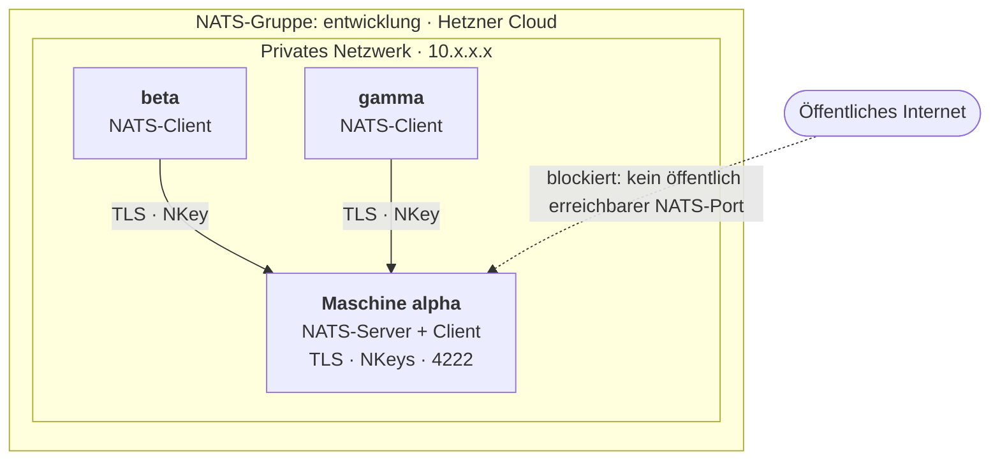
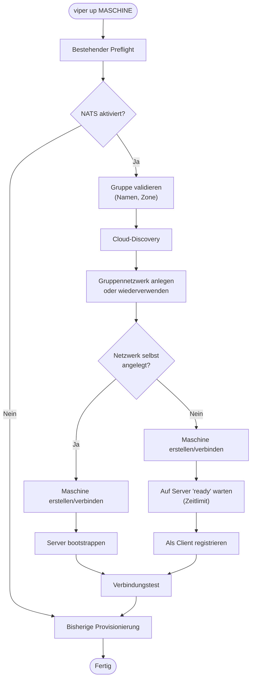

# Implementierungsplan: VIPER-Erweiterung um NATS-Gruppen

**Ziel:** VIPER verbindet mehrere Cloud-Maschinen automatisch zu einer sicheren NATS-Kommunikationsgruppe. Die erste Maschine einer Gruppe betreibt den NATS-Server, alle weiteren Maschinen werden Clients.

Die Erweiterung bleibt optional. VIPER benötigt weder einen dauerhaft laufenden Controller noch eine separate Projektdatenbank.

Der Plan berücksichtigt die bestehende Go-Architektur von VIPER, die Maschinenverwaltung über `viper up`, `viper down` und `viper check`, die Cloud-Provider-Adapter sowie das vorhandene Benutzerhandbuch.

> **Hinweis:** Meilenstein 0 ist abgeschlossen: Die Annahmen zu Code und Hetzner-API sind in §13 festgehalten und bestätigt. Offen ist nur ein optionaler Praxistest mit Servern.

## 1 Verbindliche Architektur



### Grundregeln

| Eigenschaft | Festlegung |
|--------|--------|
| Verwaltungseinheit | NATS-Gruppe, keine VIPER-Projekte |
| Konfiguration | `NATS_ENABLED`, `NATS_GROUP` |
| Serveranzahl | Genau ein NATS-Server je Gruppe |
| Serverwahl | Erste erfolgreich initialisierte Maschine (siehe §10) |
| Serverbetrieb | `nats-server`-Binary als systemd-Dienst, automatisch beim Booten (kein Docker) |
| Clients | Alle Maschinen derselben Gruppe (auch der Server selbst) |
| Discovery | Cloud-API und Maschinenmetadaten |
| Kommunikation | Privates Netzwerk |
| Authentifizierung | Individuelle NKeys |
| Verschlüsselung | TLS |
| Autorisierung | Subject-basierte ACLs |
| Zustandsverwaltung | Cloud-Metadaten und Serverkonfiguration |
| Controller | Keiner |
| Hochverfügbarkeit | Nicht Bestandteil der ersten Version |

**Wichtig:** Die NATS-Gruppe ist eine logische Zugehörigkeit von Maschinen. Sie führt kein allgemeines VIPER-Projektmodell ein.

### Bewusste Konsequenzen

- Der Server ist eine normale Entwicklermaschine. Solange die Gruppe weitere Mitglieder hat, kann sie nicht per `viper down` gelöscht werden (§8). Die Serverrolle ist damit dauerhaft an diese Maschine gebunden.
- Fällt der Server aus, ist die Gruppe nicht kommunikationsfähig. Es gibt kein Failover (§15).
- Wird NATS auf einer Gruppe aktiviert, deren Maschinen bereits ohne NATS laufen, wird nichts automatisch umgestellt. Maschinen werden erst durch ein erneutes `viper up` aufgenommen (§7). Die erste Maschine, deren `viper up` das Gruppennetzwerk erfolgreich anlegt (§10), wird Server, auch wenn sie bereits existiert. Alle weiteren werden Clients.

## 2 Konfiguration

Die NATS-Einstellungen werden in das bestehende Konfigurationssystem integriert.

```
# Optional, standardmäßig deaktiviert
NATS_ENABLED=true

# Pflichtangabe bei aktiviertem NATS
NATS_GROUP=entwicklung

# Optional, Standardwert 4222
NATS_PORT=4222
```

`NATS_PORT` ersetzt in allen folgenden Abschnitten die Angabe 4222.

Weitere Konfiguration für Serveradresse, öffentliche Ports oder private IP-Adressen ist nicht notwendig. VIPER ermittelt diese Werte automatisch.

### Validierungsregeln

- Ohne `NATS_ENABLED=true` bleibt das bisherige Verhalten unverändert.
- Bei aktiviertem NATS muss `NATS_GROUP` gesetzt sein.
- **Namensalphabet:** Gruppen- und Maschinennamen werden normalisiert (Kleinbuchstaben) und müssen `^[a-z0-9]([a-z0-9-]{0,29}[a-z0-9])?$` entsprechen (1 bis 31 Zeichen, kein Bindestrich am Anfang oder Ende; die bestehende Prüfung von Maschinennamen ist dazu eine Obermenge). Dieses Alphabet ist bewusst eng gewählt, weil die Namen in drei Kontexten gleichzeitig gültig sein müssen: NATS-Subjects (keine `.`, `*`, `>`, Leerzeichen; sonst Subject-Injection), Hetzner-Label-Werte und Ressourcennamen (Netzwerk, Server). Abweichende Namen werden abgelehnt, nicht stillschweigend umgeschrieben. Das gilt auch für bereits vorhandene Maschinen (z. B. mit Unterstrich im Namen): Mit aktiviertem NATS können sie nicht aufgenommen werden. Das Handbuch weist darauf hin.
- Eine bestehende Maschine darf nicht unbemerkt einer anderen Gruppe zugeordnet werden.
- Maschinen verschiedener Cloud-Konten oder Provider werden nicht allein wegen eines identischen Gruppennamens zusammengefasst.
- Eine NATS-Gruppe kann nur gestartet werden, wenn die benötigte private Netzwerkanbindung unterstützt wird.
- **Standort:** Alle Maschinen einer Gruppe müssen in derselben Hetzner-Network-Zone liegen (z. B. `eu-central`). Private Netzwerke sind an eine Zone gebunden; innerhalb von `eu-central` (`fsn1`, `nbg1`, `hel1`) ist eine Gruppe über mehrere Standorte möglich (§13). Die Prüfung erfolgt vor dem Erstellen jeglicher Ressourcen.

Die erste Version unterstützt **NATS-Gruppen innerhalb eines Cloud-Providers und Cloud-Kontos**. Eine providerübergreifende Gruppe ist ein späteres Feature.

## 3 Cloud-Metadaten und Gruppenerkennung

VIPER speichert die Gruppenzugehörigkeit und die NATS-Rolle direkt beim Cloud-Provider.

Konzeptionelle Metadaten:

```
viper-managed = true
viper-nats-group = entwicklung
viper-nats-role = server | client
viper-nats-state = provisioning | ready | failed
```

Die tatsächlichen Metadatennamen müssen zu den Beschränkungen der einzelnen Provider passen (bei Hetzner u. a. Zeichensatz und Länge von Label-Schlüsseln und -Werten). Das Namensalphabet aus §2 stellt das sicher.

### Discovery-Ablauf

Bei `viper up beta`:

1. VIPER lädt die konfigurierte Cloud-Provider-Instanz.
2. VIPER sucht Maschinen mit derselben NATS-Gruppe.
3. VIPER ermittelt die Maschine mit der Serverrolle.
4. VIPER liest deren private IP-Adresse aus der Cloud-API.
5. VIPER prüft, ob der Server betriebsbereit ist.
6. VIPER registriert die neue Maschine als NATS-Client.

Es wird **kein separater NATS-DNS-Eintrag** benötigt.

### Erforderliche Erweiterung der Cloud-Schnittstelle

Die bisherige Cloud-Abstraktion besitzt Funktionen wie `ServerByName`, `CreateServer` und `DeleteServer`, aber keine ausreichende Schnittstelle zur gruppenbezogenen Maschinenauflistung. Dafür wird eine zusätzliche Fähigkeit benötigt, beispielsweise:

```go
type NATSProvider interface {
    // Alle Maschinen der Gruppe inkl. Rolle, Zustand und privater IP.
    ListGroupMachines(ctx context.Context, group string) ([]model.GroupMember, error)
    UpdateNATSMetadata(ctx context.Context, serverID string, metadata model.NATSMetadata) error

    // Netzwerkzone eines Standorts ("eu-central" für fsn1).
    NetworkZone(ctx context.Context, location string) (string, error)

    // Legt das Gruppennetzwerk unter deterministischem Namen an. created ist für genau
    // einen von mehreren gleichzeitigen Aufrufern true (Basis der Erststart-Sperre, §10);
    // es wird vorher nicht gesucht.
    EnsurePrivateNetwork(ctx context.Context, group, location string) (net model.PrivateNetwork, created bool, err error)
    FindPrivateNetwork(ctx context.Context, group string) (*model.PrivateNetwork, error)

    // Für bereits vorhandene Server; neue Server werden beim Erstellen angebunden (ServerSpec.Network).
    AttachPrivateNetwork(ctx context.Context, serverID, networkID string) (privateIP string, err error)

    // ErrNetworkInUse, solange Server angebunden sind.
    DeletePrivateNetwork(ctx context.Context, networkID string) error
}
```

Die Schnittstelle ist umgesetzt (Meilensteine 2 und 3) in `internal/port/driven/cloud/nats.go`, mit dem Hetzner-Adapter und dem Test-Fake. Der Adressbereich wird automatisch gewählt (ein `/16` in `10.100.0.0` bis `10.199.0.0`, überschneidungsfrei zu vorhandenen Netzwerken) und das Netzwerk bekommt ein `/24`-Subnetz. Die NATS-spezifischen Operationen liegen in einer separaten Provider-Fähigkeit, damit andere Cloud-Adapter nicht unnötig verändert werden.

## 4 Private Netzwerke

### Hetzner Cloud

Hetzner Networks wird für NATS-Gruppen automatisch verwendet.

Bei der ersten Maschine:

1. VIPER wählt einen freien privaten Adressbereich (kein Konflikt mit vorhandenen Netzwerken im Projekt).
2. VIPER versucht, das Netzwerk `viper-nats-<gruppe>` anzulegen. Existiert es bereits, wird es wiederverwendet. Es wird bewusst nicht vorher geprüft („erst suchen, dann erstellen“ ist nicht sicher); die Eindeutigkeit des Namens ist die Sperre aus §10.
3. Nur wer das Netzwerk angelegt hat, wird Server-Kandidat (§10).
4. VIPER verbindet die Maschine mit dem Netzwerk.
5. VIPER wartet auf die betriebsbereite Netzwerkschnittstelle.
6. VIPER ermittelt die private IP-Adresse.

Bei weiteren Maschinen wird dasselbe Netzwerk wiederverwendet.

**Adresskonflikte müssen vor der Erstellung geprüft werden.** Ein fest eingebautes Subnetz wie `10.10.0.0/24` wäre ungeeignet, wenn mehrere Gruppen oder vorhandene Netzwerke existieren.

### Netzwerkfreigaben

| Verbindung | Erlaubt |
|--------|--------|
| Gruppen-Client → NATS-Server, TCP 4222 | Ja, über private IP |
| Öffentliches Internet → TCP 4222 | Nein |
| Öffentliches Internet → TCP 8222 (Monitoring) | Nein, Port wird nicht aktiviert |
| Öffentliches Internet → TCP 6222 (Cluster) | Nein, Port wird nicht aktiviert |
| VIPER → VM über bestehendes SSH | Wie bisher |
| VM → externe Paketquellen | Wie bisher, soweit erforderlich |

### Absicherung des Serverports

Hetzner Cloud Firewalls filtern laut Hetzner-Dokumentation nur den öffentlichen Verkehr, nicht das private Netzwerk (§13). Der Schutz besteht deshalb aus mehreren unabhängigen Schichten:

1. NATS lauscht ausschließlich auf der privaten IP (`host: <private-ip>`, Port aus `NATS_PORT`), niemals auf `0.0.0.0`.
2. Monitoring- (8222) und Cluster-Port (6222) bleiben deaktiviert.
3. Eine Host-Firewall-Regel (z. B. `ufw`) erlaubt den Port nur aus dem Gruppen-Subnetz. Da kein Docker beteiligt ist, wird die Regel nicht durch eigene Docker-Chains umgangen.
4. `viper check` prüft von außen, dass der Port auf der öffentlichen IP nicht erreichbar ist (§9).

### Bootreihenfolge und IP-Stabilität

- Der Dienst darf erst starten, wenn das private Interface seine IP besitzt. Die systemd-Unit startet nach `network-online.target` und wiederholt den Start bei Bindungsfehler (`Restart=on-failure`, `RestartSec`).
- Das Serverzertifikat enthält die private IP als SAN. Ändert sich die Server-IP (z. B. Netzwerk getrennt und neu verbunden), schlagen alle Clientverbindungen fehl. `viper check` meldet diese Abweichung (IP im Zertifikat ≠ IP laut Cloud-API); eine automatische Reparatur gibt es in der ersten Version nicht.

### Andere Cloud-Provider

Für AWS, GCP und Azure wird eine entsprechende Netzwerkanbindung benötigt. Da dort bestehende VPCs, VNets, Subnetze und Sicherheitsregeln betroffen sein können, darf VIPER keine fremden Netzwerke ungefragt verändern.

Die erste Ausbaustufe wird deshalb mit Hetzner vollständig implementiert und getestet. Weitere Provider folgen über dieselbe fachliche Schnittstelle.

## 5 NATS-Server-Bootstrap

Der Server wird im bestehenden Provisionierungsablauf von `viper up` eingerichtet.

### Ablauf

1. Maschine erstellen oder vorhandene Maschine wiederverwenden.
2. Privates Netzwerk bereitstellen und verbinden.
3. SSH-Erreichbarkeit sicherstellen.
4. `nats-server`-Binary installieren (siehe unten).
5. Selbstsigniertes Serverzertifikat samt Schlüssel erzeugen (siehe unten).
6. NATS-Serverkonfiguration erzeugen, einschließlich NKey des Servers selbst (alpha ist auch Client, siehe §6).
7. systemd-Dienst anlegen, aktivieren und starten.
8. NATS-Healthcheck durchführen.
9. Verbindung über private IP und TLS testen.
10. Serverrolle als `ready` markieren.

### Installation und Betrieb

`nats-server` wird nicht als Container betrieben, sondern als Binary aus dem offiziellen GitHub-Release. `viper up` installiert es im Bootstrap per SSH, nur auf der Servermaschine (nicht in `cloud-init.yaml`, weil NATS optional ist und Clients es nicht brauchen).

- **Version und Prüfsumme** sind in VIPER fest hinterlegt (je Architektur `amd64` und `arm64`, da die Hetzner-Typen gemischt sind). Der Download wird gegen die SHA-256-Summe geprüft; bei Abweichung bricht der Bootstrap ab.
- **Ablage:** Binary unter `/usr/local/bin/nats-server`, Konfiguration und Schlüssel in einem Verzeichnis des Nutzers `builder` (Modus `0700`, Dateien `0600`).
- **systemd-Dienst:** läuft als `builder`, startet beim Booten, mit Härtung (`NoNewPrivileges=yes`, `ProtectSystem=strict`, `ProtectHome=read-only` mit Schreibzugriff nur auf das Konfigurationsverzeichnis, `PrivateTmp=yes`).
- **Wiederholte Starts** sind idempotent: Ist die gepinnte Version bereits installiert, wird der Download übersprungen.
- **Healthcheck:** `nats-server` im Dienst läuft; der Test in §5 Schritt 9 verbindet über private IP und TLS.

Für Core NATS ist keine persistente Nachrichtenspeicherung vorgesehen. **JetStream wird nicht aktiviert.**

### TLS-Zertifikat

**Festlegung:** Es gibt keine eigene CA. Der Server erhält ein selbstsigniertes **Blattzertifikat** (`CA:FALSE`, `serverAuth`; mit `CA:TRUE` lehnen rustls-Clients es ab, siehe `nats-jetstream-nuntius.md` §13/Meilenstein 0), dessen Schlüssel die Servermaschine nie verlässt (Eigentümer `builder`, Modus `0600`, ohne `sudo`). Die Clients vertrauen ausschließlich diesem Zertifikat (in der Clientkonfiguration als `ca_file` bzw. Vertrauensanker eingetragen). Die Clientauthentifizierung läuft über NKeys, TLS dient der Serverauthentifizierung und der Verschlüsselung.

- Das Zertifikat enthält die private IP als SAN. Alternativ kann ein vorhandener Maschinen-DNS-Name verwendet werden, sofern die Verbindung dann über diesen Namen aufgebaut und bei der TLS-Prüfung ausdrücklich verwendet wird.
- **Laufzeit:** 1 Monat, **keine automatische Erneuerung**, analog zum bestehenden SSH-Host-Zertifikat (sieben Tage, ohne Erneuerung). Gruppen laufen typischerweise 1 Tag bis 2 Wochen und damit deutlich kürzer als das Zertifikat. Die kurze Laufzeit begrenzt zugleich den Schaden bei einem abgeflossenen Schlüssel. Ein zu lang laufendes Zertifikat benötigt keine Rotationslogik: Bei Ablauf wird die Gruppe neu aufgebaut.
- **Ablaufwarnung:** `viper check` warnt, wenn weniger als 7 Tage Restlaufzeit bleiben, und meldet den Ablauf als Fehler. `viper up` für eine neue Maschine in einer Gruppe mit abgelaufenem Zertifikat bricht mit einer klaren Meldung ab (kein Aufnehmen neuer Clients in eine nicht mehr nutzbare Gruppe). Das Handbuch nennt die maximale Gruppenlaufzeit.
- **Verlust des Servers:** Geht der Server verloren, wird die Gruppe neu aufgebaut (konsistent mit „kein Failover“, §15).
- Die vorhandene SSH-Host-CA ist nicht für NATS geeignet. Die beiden Vertrauensbereiche bleiben getrennt.
- Schlüssel oder Seeds dürfen nie in Cloud-Metadaten liegen.

## 6 Authentifizierung und Berechtigungen

Jede Maschine erhält eine eigene NATS-Identität, auch die Servermaschine selbst.

### Registrierung

Bei `viper up beta`:

1. VIPER erzeugt das NKey-Paar im Speicher (Go-Bibliothek `nkeys`); auf der VM ist dafür kein Zusatzprogramm nötig.
2. VIPER schreibt den Seed per SSH-Stdin auf beta (`~/.viper-nats/client.nk`, Modus `0600`, Eigentümer `builder`). Lokal wird er weder gespeichert noch protokolliert; er berührt den Operator-Rechner nur im Arbeitsspeicher. Hat beta bereits eine Identität, bleibt sie erhalten.
3. VIPER erhält den öffentlichen Schlüssel von der VM (`client.pub`).
4. VIPER verbindet sich über SSH mit dem NATS-Server.
5. Auf dem Server wird unter einem Dateilock (`flock`) der öffentliche Schlüssel mit den passenden Berechtigungen in die Konfiguration eingetragen. Das Lock serialisiert parallele Registrierungen (z. B. gleichzeitiges `up beta` und `up gamma`).
6. Die Konfiguration wird atomar ersetzt (Schreiben in temporäre Datei, Validierung, `rename`).
7. NATS übernimmt die Änderung per Reload.
8. beta führt einen authentifizierten Verbindungstest aus.

Es gibt keinen zentralen Dienst, der dauerhaft Schlüssel verwaltet.

### Subject-Berechtigungen

Namensstruktur:

```
viper.<gruppe>.<maschine>.>
```

Beispiele:

```
viper.entwicklung.alpha.status
viper.entwicklung.beta.jobs
viper.entwicklung.gamma.events
```

**Festgelegte Standardrichtlinie der ersten Version** (je Maschine `<m>` in Gruppe `<g>`):

| Recht | Subjects | Zweck |
|--------|--------|--------|
| Publish | `viper.<g>.<m>.>` | Eigene Ereignisse und Status (Broadcast) |
| Publish | `viper.<g>.*.req.>` | Anfragen an andere Maschinen |
| Subscribe | `viper.<g>.>` | Gruppenweite Ereignisse und Anfragen |
| Subscribe | `_INBOX.<m>.>` | (seit v0.15.1 ungenutzt, bleibt bestehen) |

Anfragen an eine Maschine gehen an `viper.<g>.<empfänger>.req.<name>`, zum Beispiel `viper.entwicklung.gamma.req.build`. Diesen Teilbaum darf **jede** Maschine beschreiben; der Absender ist dort also nicht belegt. **Antworten über das NATS-Reply-Feld gibt es nicht:** `allow_responses` ist seit v0.15.1 nicht mehr gesetzt (siehe unten). Wer antwortet, veröffentlicht eine normale Nachricht in seinem eigenen Bereich, zum Beispiel `viper.<g>.<antwortender>.res.<anfragender>`; der Anfragende liest sie mit und erkennt am dritten Token, wer geantwortet hat. Das Recht, `_INBOX.<m>.>` zu lesen, bleibt aus Kompatibilität bestehen, wird aber nicht mehr gebraucht. Die Standardrichtlinie ist bewusst offen für Lesen innerhalb der Gruppe: Jede Maschine kann alle Subjects der Gruppe mithören. Eine pauschale Freigabe auf `>` ist ausgeschlossen, ebenso Zugriff auf Subjects anderer Gruppen. Feinere, konfigurierbare Richtlinien sind ein späteres Feature; die Standardrichtlinie wird durch Unit-Tests der ACL-Erzeugung und durch einen Test mit einem echten NATS-Server abgesichert (§12).

**Behoben in v0.15.1 (gefunden am 09.11.2026, betraf v0.15.0):** Die Sendeliste hielt nur gegen **direktes** Senden. `allow_responses: true` erlaubte einer Maschine, auf das Reply-Subject jeder Nachricht zu antworten, die ihr **zugestellt** wurde, ohne die Sendeliste zu prüfen. Weil jede Maschine `viper.<g>.>` liest und das Reply-Feld einer Nachricht frei wählbar ist, konnte jede Maschine auf **jedes** Subject der Gruppe senden. Mit `nats-server` 2.15.2 und den Rechten aus `Render` nachgewiesen:
* *Eigenschleife:* Maschine C sendet `viper.<g>.c.x` mit `Reply=viper.<g>.a.out.b`, bekommt ihre eigene Nachricht zurück und antwortet darauf; B empfängt die Nachricht auf `viper.<g>.a.out.b`, ohne dass der Server einen Fehler meldet.
* *Dritter:* C beantwortet eine fremde Anfrage von A (`Reply=_INBOX.a.1`); A erhält die Antwort.
* *Frei gewähltes Reply-Feld:* C bittet B mit `Reply=viper.<g>.a.out.c` um eine Antwort; B veröffentlicht damit in A's Teilbaum.

Seit v0.15.1 schreibt `Render` kein `allow_responses` mehr; alle drei Wege (und das direkte Senden) werden vom Server mit `Permission Violation` abgelehnt. Ein Test mit `nats-server` als Bibliothek (`internal/natsserver/forge_test.go`) prüft das mit den echten Rechten und schlägt an, wenn `allow_responses` zurückkehrt. Gruppen, die mit v0.15.0 angelegt wurden, behalten die Lücke, bis ein weiteres `viper up` auf einem Rechner der Gruppe die Konfiguration neu schreibt. Die Aussage „Wer sendet, steht im Subject“ gilt damit für den eigenen Teilbaum (`viper.<g>.<m>.>`); der Teilbaum `viper.<g>.*.req.>` bleibt ein offener, nicht authentifizierter Kanal.

### Schlüsselablage

| Schlüsselmaterial | Speicherort |
|--------|--------|
| Privater Client-NKey (Seed) | Ausschließlich jeweilige VM |
| Öffentlicher Client-NKey | NATS-Serverkonfiguration |
| Privater TLS-Serverschlüssel | NATS-Servermaschine |
| Serverzertifikat (öffentlich, Vertrauensanker) | Alle Gruppenmaschinen |

## 7 Integration in `viper up`

Der bisherige Ablauf wird erweitert, nicht ersetzt.



Die genaue Reihenfolge gegenüber Repository-, Tool- und Login-Provisionierung wird so gewählt, dass Fehler wiederholbar und bereits erfolgreiche Schritte idempotent sind.

### Wiederholte Starts

`viper up beta` darf nicht bei jedem Aufruf neue Identitäten erzeugen.

Stattdessen prüft VIPER:

- Existiert bereits eine gültige Identität?
- Stimmt die gespeicherte Gruppenzugehörigkeit?
- Ist der NATS-Server erreichbar?
- Muss eine fehlgeschlagene Registrierung vervollständigt werden?
- Ist das Serverzertifikat noch gültig (§5)?

## 8 Integration in `viper down`

### Client löschen

Bei `viper down beta`:

1. Gruppenmitgliedschaft ermitteln.
2. NATS-Server ermitteln.
3. Clientidentität widerrufen: Eintrag unter Dateilock aus der Serverkonfiguration entfernen und NATS neu laden.
4. Prüfen, dass bestehende Verbindungen beendet wurden (Reload schließt Verbindungen entfernter Schlüssel; *durch Integrationstest zu belegen*).
5. Maschine über den bisherigen VIPER-Ablauf löschen.

**Sicherheitsregel:** Schlägt der Widerruf fehl, darf VIPER nicht stillschweigend eine weiterhin gültige Identität zurücklassen. Der Löschvorgang wird abgebrochen.

**Ausweg bei nicht erreichbarem Server:** `viper down beta --force` löscht die Maschine trotz fehlgeschlagenem Widerruf, nach einer ausdrücklichen Warnung. Das ist vertretbar, weil der Seed ausschließlich auf der gelöschten VM lag. Die Warnung nennt den verbleibenden Eintrag in der Serverkonfiguration. `viper check` meldet verwaiste Registrierungen, deren Maschine nicht mehr existiert.

### NATS-Server löschen

Bei `viper down alpha`:

- Existieren weitere Gruppenmaschinen (in beliebigem Zustand, auch `provisioning` oder `failed`), wird das Löschen verweigert.
- Ist alpha das einzige Gruppenmitglied, kann die Maschine gelöscht werden. Gleichzeitig laufende `viper up`-Aufrufe derselben Gruppe sind durch dieselbe Sperre wie beim Erststart (§10) zu schützen: Vor dem Löschen wird die Mitgliederliste erneut geprüft.
- Danach entfernt VIPER das verwaltete private Netzwerk, sofern keine anderen Ressourcen es verwenden.
- Mit `--force` kann der Server auch bei vorhandenen Clients gelöscht werden. Die Gruppe ist danach aufgelöst, alle Clients verlieren ihre Verbindung. Das erfordert eine ausdrückliche Bestätigung.

Es gibt zunächst **keine automatische Servermigration**.

## 9 Integration in `viper check`

`viper check` bleibt grundsätzlich lesend.

Ergänzende Prüfungen, getrennt nach Ausführungsort:

| Prüfung | Erwartung | Ausführung |
|--------|--------|--------|
| Gruppenzugehörigkeit | Eindeutig | Cloud-API |
| Serverrolle | Genau eine | Cloud-API |
| Serverstatus | `ready` | Cloud-API |
| Privates Netzwerk | Vorhanden | Cloud-API |
| Private IP | Zugewiesen, passt zum Zertifikats-SAN | Cloud-API, SSH |
| Verwaiste Registrierungen | Keine | SSH auf Server |
| TCP-Verbindung | Erfolgreich | SSH auf Gruppenmaschine |
| TLS-Zertifikat | Gültig, Restlaufzeit ≥ 7 Tage | SSH auf Gruppenmaschine |
| NKey-Authentifizierung | Erfolgreich | SSH auf Gruppenmaschine |
| NATS-Ping | Erfolgreich | SSH auf Gruppenmaschine |
| Öffentlich erreichbarer Port | Nicht vorhanden | Direkt vom Operator-Rechner gegen die öffentliche IP |

Die private IP des Servers ist vom Operator-Rechner aus nicht erreichbar. Alle Verbindungsprüfungen laufen deshalb per SSH auf einer Gruppenmaschine, die ihren eigenen Seed verwendet. Nur die Prüfung auf öffentliche Erreichbarkeit muss von außen erfolgen.

Ein fehlgeschlagener Check zeigt die Ursache an, verändert aber nicht automatisch Infrastruktur oder Zugangsdaten.

## 10 Parallelität und Fehlerbehandlung

Dies ist einer der kritischsten Teile der Erweiterung.

### Gleichzeitiger Erststart

Zwei gleichzeitige Aufrufe dürfen nicht zwei unabhängige Server erzeugen. Cloud-Labels allein sind kein ausreichender Lock, da sie kein Compare-and-Set bieten.

**Vorgesehene Strategie:** Das Gruppennetzwerk `viper-nats-<gruppe>` dient als atomare Reservierung. Hetzner erzwingt eindeutige Netzwerknamen je Projekt (per API-Test bestätigt, auch bei 10 parallelen Versuchen, §13).

1. Jeder `up`-Aufruf versucht, das Netzwerk anzulegen (`EnsurePrivateNetwork`).
2. Wer es erfolgreich anlegt (`created == true`), ist Server-Kandidat und bootstrapt den Server.
3. Alle anderen erhalten einen Uniqueness-Fehler und werden Clients. Sie warten (mit Zeitlimit) darauf, dass die Serverrolle `ready` ist.
4. **Wiederanlauf nach Fehlern:** Es gibt keine automatische Übernahme der Serverrolle, denn Labels bieten keine atomare Übernahme.
   - *Kandidat scheitert, bevor ein Gruppenmitglied existiert:* Der Kandidat löscht das von ihm angelegte Netzwerk wieder, sodass der nächste `up` neu beginnen kann.
   - *Kandidat scheitert nach dem Anlegen der VM:* Die VM trägt Serverrolle und Zustand `failed`. Ein erneutes `viper up` derselben Maschine setzt den Bootstrap idempotent fort.
   - *Kandidat bricht unkontrolliert ab (Absturz, Abbruch des Prozesses):* Netzwerk existiert, aber kein Server hat `ready`. Wartende Clients brechen nach dem Zeitlimit mit einer eindeutigen Fehlermeldung ab, die auf `viper up` der Servermaschine bzw. `viper down` zur Bereinigung verweist. Eine zweite Serverrolle wird nie vergeben.
   - Ein Netzwerk ohne jedes Gruppenmitglied wird von `viper down` der zuletzt verbliebenen Maschine bzw. durch einen expliziten Bereinigungsaufruf entfernt.

**Ohne nachgewiesene atomare Koordination wird die gleichzeitige Erstinitialisierung nicht freigegeben.** Ist die Eindeutigkeit von Netzwerknamen nicht gesichert, wird eine andere atomare Cloud-Ressource gewählt oder die parallele Erstinitialisierung verboten (nur sequenzieller Start, dokumentiert im Handbuch). Ein bloßes „erst suchen, dann erstellen“ ist nicht sicher.

### Gleichzeitige Registrierungen und Löschungen

Konfigurationsänderungen auf dem Server sind durch Dateilock serialisiert (§6, §8). Löschen des letzten Mitglieds und gleichzeitiger Beitritt werden durch erneutes Prüfen der Mitgliederliste vor dem Löschen abgesichert (§8).

### Fehlerfälle

| Fehler | Verhalten |
|--------|--------|
| Netzwerk erstellt, VM-Erstellung schlägt fehl | Vom Kandidaten angelegtes, unbenutztes Netzwerk wieder löschen (§10) |
| Netzwerk vorhanden, aber kein `ready`-Server | Clients brechen nach Zeitlimit ab; keine automatische Serverübernahme |
| VM erstellt, NATS-Bootstrap schlägt fehl | Zustand `failed`, sicherer Wiederanlauf |
| Server nicht erreichbar | Keine zweite Serverinstanz erzeugen |
| Clientregistrierung unvollständig | Idempotent fortsetzen |
| TLS-Zertifikat ungültig oder abgelaufen | Verbindung verweigern, `check` meldet Ursache |
| Mehrere Serverrollen gefunden | Vorgang abbrechen |
| Cloud-API nicht erreichbar | Keine Vermutungen über Gruppenzustand |
| Gruppenname geändert | Explizite Fehlermeldung statt stiller Migration |
| Privates Netzwerk entfernt | Fehler melden; nicht auf öffentlichen NATS-Port ausweichen |
| Server-IP geändert | `check` meldet SAN-Abweichung; keine automatische Reparatur |
| Widerruf bei `down` schlägt fehl | Abbruch; nur mit `--force` fortsetzbar |

## 11 Änderungen an der Go-Codebasis

Die folgende Zuordnung orientiert sich an der bestehenden hexagonalen Struktur (vor Umsetzung gegen den Code zu prüfen).

| Bereich | Aufgabe |
|--------|--------|
| `internal/model/` | NATS-Gruppe, Rolle, Zustand, Netzwerkdaten, Namensvalidierung |
| `internal/port/driven/cloud/` | Discovery und private Netzwerke |
| `internal/port/driven/` | NATS-Provisionierungs- und Identitätsports |
| `internal/adapter/driven/hetzner/` | Hetzner Networks, Metadaten, private IPs |
| `internal/adapter/driven/` | NATS-Konfiguration, Zertifikate, Binary-Installation und systemd-/SSH-Operationen |
| `internal/usecase/start/` | Serverwahl, Bootstrap, Clientregistrierung |
| `internal/usecase/stop/` | Widerruf, Löschschutz, `--force`, Netzwerkbereinigung |
| `internal/usecase/check/` | Diagnose und Verbindungstests |
| `internal/app/` | Dependency Injection und Feature-Aktivierung |
| `docs/user/handbuch.md` | Konfiguration, Beispiele, Fehlerbehebung |
| `docs/maintainer/` | Architektur und Sicherheitsmodell |

Eine eigene fachliche NATS-Komponente ist sinnvoll, damit die Abläufe nicht als große zusätzliche Funktionen in `start.go` und `stop.go` landen.

## 12 Teststrategie

### Unit-Tests

- Konfigurationsvalidierung und Namensalphabet (inkl. Injection-Versuche wie `a.b`, `a*`, `a>`).
- Gruppenidentifikation.
- Rollenauflösung.
- Idempotente Registrierung.
- Löschschutz und `--force`.
- Fehlerbehandlung.
- ACL-Erzeugung gemäß Standardrichtlinie (§6).
- Erststart-Logik mit Fake-Provider: parallele Aufrufe, genau ein `created == true`.

### Integrationstests

- NATS-Server als Prozess (lokal oder in einem Test-Container).
- Zwei und drei Clients.
- TLS-Validierung, abgelaufenes und falsches Zertifikat.
- Abgelaufenes Zertifikat: `check` meldet Fehler, `up` nimmt keine neuen Clients auf.
- Authentifizierung mit NKeys.
- Publish/Subscribe sowie Request/Reply (`…<empfänger>.req.…`) gemäß ACL; verbotene Subjects (fremde Maschinen-Subtrees, andere Gruppen, fremde Inboxen) werden abgelehnt.
- Widerruf einer Identität schließt bestehende Verbindungen.
- Parallele Registrierungen (Dateilock).
- Neustart des Servers.
- Fehler bei unterbrochener Verbindung.

### Cloud-Tests

- Privates Hetzner-Netzwerk erstellen; Eindeutigkeit des Netzwerknamens bestätigen.
- Maschinen verbinden, Zonenprüfung.
- Private IP-Adressen ermitteln.
- Dienststart nach Reboot (Bootreihenfolge).
- Installation auf `amd64` und `arm64` mit Prüfsummenprüfung; Abbruch bei falscher Prüfsumme.
- Port 4222 auf öffentlicher IP nicht erreichbar.
- Netzwerk nach Löschung bereinigen.
- Wiederholte `up`-Aufrufe.
- Parallele Erststarts.
- Wiederherstellung nach fehlgeschlagenem Bootstrap.

### Regressionstests

Alle bestehenden Tests müssen auch mit deaktiviertem NATS erfolgreich bleiben.

## 13 Umsetzung in Meilensteinen

Die Reihenfolge folgt der Empfehlung in §15. Jeder Meilenstein ist einzeln abnehmbar.

| Nr. | Meilenstein | Ergebnis |
|--------|--------|--------|
| 0 | Verifikation | Hetzner-Annahmen (eindeutige Netzwerknamen, Zonen, Label-Grenzen) und Code-Schnittstellen (§3, §11) geprüft; Plan angepasst |
| 1 | Gruppenmodell und Konfiguration | `NATS_*`-Einstellungen, Namensvalidierung, Modelltypen; Regressionstests grün |
| 2 | Hetzner-Discovery | `ListGroupMachines`, Metadaten lesen/schreiben |
| 3 | Private Netzwerke | `EnsurePrivateNetwork`, Anbindung, private IP, Bereinigung; Erststart-Sperre über Netzwerkname |
| 4 | NATS-Server-Bootstrap | Binary-Installation, systemd-Dienst, Zertifikat samt Verteilung an Clients, gebundener Port, Healthcheck |
| 5 | Clientregistrierung | NKeys, ACLs, Dateilock, Reload, Verbindungstest; zwei Maschinen kommunizieren sicher |
| 6 | Lifecycle (`down`) | Widerruf, Löschschutz, `--force`, Netzwerkbereinigung |
| 7 | Diagnose (`check`) und Dokumentation | Prüfungen aus §9, Handbuch, Maintainer-Doku, Definition of Done erfüllt |

Meilenstein-Status wird in den jeweiligen Pull Requests geführt, nicht in diesem Dokument.

### Ergebnis Meilenstein 7 (`viper check` und Dokumentation)

Umgesetzt in `internal/usecase/check/natschecks.go` und `natsstatus.sh`. Der Abschnitt `== NATS (group …)` erscheint für jede Maschine mit NATS-Labels (und als Warnung, wenn `NATS_ENABLED` an ist, die Maschine aber in keiner Gruppe). Er prüft in drei Teilen, ohne etwas zu ändern:
- **Beim Anbieter:** Gruppe (und Abgleich mit `NATS_GROUP`), genau ein Server, Zustand der Server (`ready`, `provisioning` als Warnung, `failed`), privates Netzwerk, private Adresse der Maschine.
- **Auf der Maschine (per SSH):** `connection.env` vorhanden, Zertifikat (fehlt, abgelaufen, läuft in weniger als 7 Tagen ab, gilt für eine andere Adresse als die des Servers), Anmeldung mit dem NKey über TLS und, auf dem Server, der Dienst, die Adresse, auf der er lauscht (nur die private), sowie wer registriert ist (verwaiste Einträge als Warnung, fehlende bereite Clients als Fehler).
- **Von außen:** Die öffentliche Adresse darf auf dem NATS-Port nicht antworten.

Dokumentation: Kapitel „Rechner über NATS verbinden“, Einstellungen, Fehlerbehebung, Glossar und Änderungshistorie im Handbuch (1.73), Abschnitt „NATS-Gruppen“ in `docs/maintainer/architektur.md`.

Praktisch bestätigt (zwei `cpx22`, danach gelöscht): gesunde Gruppe (`Check OK.` für Server und Client), Wiederanlauf einer Gruppe im Zustand `failed` mit `viper up`, gestoppter Dienst (Server: Dienst inaktiv, nichts lauscht, Login fehlgeschlagen; Client: Login fehlgeschlagen), nicht registrierter bereiter Client.

Gefundene Fehler in diesem Meilenstein:
- `nats rtt` beendet sich auch bei gestopptem Server und abgelehntem Schlüssel mit Status 0. Der Verbindungstest von `viper up` (seit Meilenstein 5) und der Check meldeten deshalb fälschlich Erfolg. Beide veröffentlichen jetzt eine Nachricht im eigenen Bereich (`nats pub`, Status 1 bei Fehlern).
- Ein kurzer SSH-Abbruch (`Connection reset`), während der neue Server noch neu startet, ließ `viper up` scheitern. Verbindungsfehler werden jetzt bis zu 12 Mal wiederholt (die Skripte sind wiederholbar).

Damit sind alle Meilensteine umgesetzt; die Definition of Done (§14) ist erfüllt, mit der Einschränkung zu Punkt 11: parallele Erststarts sind unterstützt und wurden mit mehreren Maschinen echt getestet.

### Ergebnis Meilenstein 6 (`viper down`)

Umgesetzt in `internal/usecase/stop/nats.go`; die gemeinsamen SSH-Operationen von `up` und `down` liegen in `internal/usecase/natsgroup` (SSH-Zugang zu einer anderen Maschine der Gruppe, Änderung der Clientliste mit Hash-Prüfung unter `flock`). Maßgeblich sind die Labels der Maschine, nicht `NATS_ENABLED`: eine Maschine mit NATS-Labels wird als Gruppenmitglied behandelt.

- **Client:** Vor dem Löschen wird sein Schlüssel aus der Serverkonfiguration entfernt und der Server lädt neu. Schlägt das fehl, wird die Maschine nicht gelöscht (Meldung mit Hinweis auf `--force`). Mit `--force` wird sie trotzdem gelöscht, mit Warnung, dass der Eintrag bis zum Löschen des Servers bleibt. Hat die Gruppe keinen Server mehr, gibt es nichts zu widerrufen.
- **Server:** Hat die Gruppe weitere Maschinen (in jedem Zustand), wird er nicht gelöscht und es gibt nicht einmal eine Rückfrage. Mit `--force` muss zusätzlich der Gruppenname eingegeben werden; die Gruppe endet, die Clients verlieren die Verbindung.
- **Netzwerk:** Mit der letzten Maschine der Gruppe wird das private Netzwerk entfernt, vorher bleibt es bestehen.
- Maschinen ohne NATS-Labels werden unverändert gelöscht, ohne ein Wort zu NATS.

Praktisch bestätigt (zwei `cpx22`, danach gelöscht):
- Ein NATS-Server schließt beim Neuladen ohne einen Benutzer dessen Verbindung (`Disconnected ... EOF`), jede Wiederverbindung scheitert mit `authorization violation`; die Verbindung des anderen Benutzers bleibt. Damit ist die Annahme aus §8 belegt.
- `viper down alpha` wurde abgelehnt, solange Beta in der Gruppe war.
- `viper down beta` entfernte den Schlüssel (`nats config: written, server reloaded`), in der Konfiguration blieb nur Alpha, und Beta wurde gelöscht.
- `viper down alpha` als letzte Maschine löschte auch das Netzwerk `viper-nats-live`.
- Der Parallelstart von Alpha und Beta funktionierte mit dem neuen Wartefenster (Beta wartete auf den Server).

Nicht Teil von `down`: das gemeinsame Login-Schlüsselpaar und die Firewall des Präfixes bleiben wie bisher bestehen.

### Ergebnis Meilenstein 5 (Clientregistrierung)

Umgesetzt in `internal/usecase/start/nats.go`. Ein Client wartet auf den Server (`ready`, höchstens 5 Minuten; ein ausgefallener Server beendet das Warten sofort), erreicht ihn per SSH (die SSH-Konfiguration des Servers wird bei Bedarf lokal angelegt), installiert das `nats`-Werkzeug (`v0.5.1`, gepinnte Prüfsumme), legt seine Identität an, trägt sich in die Serverkonfiguration ein, bekommt das Serverzertifikat und die Datei `connection.env` und meldet sich zur Probe mit dem NKey an.

- **Registrierung ohne verlorene Einträge:** Die Konfiguration trägt am Anfang eine maschinenlesbare Liste (`# viper-client <maschine> <schlüssel>`). Ein Schreiber liest sie mit dem Hash der Datei, ergänzt seinen Eintrag und schreibt nur zurück, wenn der Hash unter dem `flock` noch stimmt, sonst liest er neu (bis zu 6 Versuche). Das gilt auch für den Server selbst.
- **Paralleler Erststart:** Ein Netzwerk ohne Server, das jünger als 15 Minuten ist, gilt als „erste Maschine wird noch angelegt“: die Clients legen ihre Maschinen an und warten. Ein älteres Netzwerk ohne Server gilt als unterbrochener Start und wird mit klarer Meldung abgelehnt. Das zeigte der erste echte Parallelstart.

Praktisch bestätigt (drei `cpx22` in `fsn1`, danach gelöscht):
- Alpha (Server) und danach Beta und Gamma gleichzeitig mit einem erneuten Lauf von Alpha: alle drei Registrierungen sind in der Konfiguration, keine ging verloren.
- (Hinweis: Das hier beschriebene Anfrage/Antwort-Verfahren über das NATS-Reply-Feld gibt es seit v0.15.1 nicht mehr, siehe §6.) Broadcast: Gamma empfängt, was Beta auf `viper.live.beta.status` veröffentlicht. Anfrage/Antwort: Beta fragt `viper.live.alpha.req.echo`, Alpha antwortet (`pong from alpha`, rtt 0,6 ms; Voraussetzung ist das eigene Inbox-Präfix `_INBOX.<maschine>`, das `connection.env` als `NATS_INBOX_PREFIX` liefert). Veröffentlichen in den Subtree einer anderen Maschine oder in eine andere Gruppe wird abgelehnt.
- Die ACL-Entscheidung aus §6 trägt: Request-Subjects `viper.<g>.<empfänger>.req.>` gehen, alles andere fremde nicht.


### Ergebnis Meilenstein 4 (Server-Bootstrap)

Umgesetzt in `internal/natsserver` (Konfiguration, Unit, gepinntes Release `v2.15.2` mit SHA-256 je Architektur, NKey-Erzeugung) und `internal/usecase/start/nats.go` mit den Skripten `scripts/nats*.sh`. Mit `NATS_ENABLED` bestimmt `viper up` vor dem Erstellen die Rolle (Erststart-Sperre über das Netzwerk), legt den Server mit Labels und Netzwerk an, installiert nach dem SSH-Login das Binary mit Prüfsumme, erzeugt das Zertifikat und die Identität, schreibt die Konfiguration (mit `flock` und `nats-server -t` vor dem Ersetzen) und startet den systemd-Dienst. Anschließend prüft `natscheck.sh`, dass der Server auf der privaten IP antwortet und TLS sowie Login verlangt.

Praktisch auf einem echten Hetzner-Server (`cpx22`, `fsn1`) bestätigt:
- Der Download passt zur gepinnten Prüfsumme; der Dienst läuft als `builder`, lauscht nur auf `10.x.x.x:4222`, Port 4222 ist von außen nicht erreichbar, 8222 und 6222 sind nicht offen.
- Mit einem Testclient auf dem Server: TLS und NKey-Login funktionieren, Publish/Subscribe im eigenen Subtree geht, Publish auf fremde Maschinen-Subtrees, andere Gruppen, fremde Subjects und `$SYS` sowie Subscribe auf andere Gruppen werden mit `Permissions Violation` abgelehnt. Ein Client, der dem Zertifikat nicht vertraut, kommt nicht durch.
- Ein zweiter `viper up` ist idempotent: Binary, Zertifikat und Identität bleiben, die Konfiguration wird neu geschrieben und per Reload übernommen.
- Labels am Server: `viper-managed=true`, Gruppe, Rolle `server`, Zustand `ready`.


### Ergebnis Meilenstein 0 (Code-Abgleich und Hetzner-Tests)

Gegen den Code geprüft:

- **Bestätigt:** `cloud.Provider` hat `ServerByName`, `CreateServer`, `DeleteServer`, `EnsureLoginKey`, `EnsureFirewall`; die Pakete `internal/{model,port/driven/cloud,adapter/driven/hetzner,usecase/{start,stop,check},app}` und die Dokumente `docs/user/handbuch.md`, `docs/maintainer/` existieren. Der SSH-Nutzer ist `builder` (`sshconfig`).
- **Einstellungen:** Maschinen werden über `.env.local` und `machines/<maschine>.env.local` konfiguriert; die Serverbezeichnung ist `<SERVER_PREFIX>-<maschine>`. `NATS_*` wird dort gelesen (umgesetzt in Meilenstein 1).
- **Folge für die Cloud-Schnittstelle:** `cloud.Provider` wird von vier Adaptern (Hetzner, AWS, GCP, Azure) und dem Test-Fake implementiert. Die NATS-Fähigkeit (§3) wird daher als eigene, optionale Schnittstelle umgesetzt, die der Hetzner-Adapter zusätzlich erfüllt und die per Typprüfung abgefragt wird.
- **Hetzner-Adapter:** nutzt `hcloud-go` v2.53; **Labels und Netzwerke sind noch nicht umgesetzt** (`ServerCreate` setzt keine Labels, es gibt keine Netzwerkfunktionen). Das Auflisten per Label-Selektor und das Anlegen von Netzwerken sind mit `hcloud-go` möglich. Ein Server kann direkt bei der Erstellung an ein Netzwerk gebunden werden, was die nachträgliche Anbindung (§4) nur für bereits vorhandene Maschinen nötig macht.

Gegen die echte Hetzner-API geprüft (kostenlose Tests mit Netzwerken, anschließend vollständig gelöscht):

- **Eindeutige Netzwerknamen: bestätigt.** Ein zweites Netzwerk mit gleichem Namen wird mit `uniqueness_error` („name is already used“) abgelehnt. Bei 10 gleichzeitigen Anlegeversuchen gelang genau einer, die anderen neun scheiterten mit `uniqueness_error`. Die Erststart-Sperre aus §10 ist damit tragfähig.
- **Network Zones:** `fsn1`, `nbg1`, `hel1` liegen in `eu-central`, `ash` in `us-east`, `hil` in `us-west`, `sin` in `ap-southeast`. Die Zonenprüfung aus §2 ist über die Location-Liste der API möglich.
- **Label-Grenzen:** Werte und Schlüssel bis 63 Zeichen; 64 werden abgelehnt. Werte müssen mit einem Buchstaben oder einer Ziffer beginnen und enden (`-a` wird abgelehnt). Bindestrich, Punkt und Unterstrich sind im Wert erlaubt, ebenso Großbuchstaben. Das Namensalphabet aus §2 ist eine Teilmenge davon. Ein leerer Wert ist zulässig.
- **Server-Test (praktisch bestätigt, zwei `cax11` in `fsn1`, danach gelöscht):**
  - *Netzwerk beim Erstellen:* Ein Server lässt sich beim Erstellen direkt an das Netzwerk binden (`networks` in `ServerCreate`). Die private IP steht sofort in der Antwort (`private_net[0].ip`, hier `10.234.0.2` und `10.234.0.3`). Das private Interface (`enp7s0`) ist nach dem Start vorhanden und hat die IP.
  - *Cloud-Firewall:* Eine Firewall, die von außen nur TCP 22 erlaubt, blockiert den öffentlichen Zugriff auf einen Listener (Port 8080), lässt aber den Zugriff über die private IP zu (HTTP 200 von der zweiten Maschine). Die Cloud-Firewall filtert den privaten Verkehr also nicht; die Absicherung in §4 (Bindung an die private IP, Host-Firewall) ist notwendig.
  - *Zonen:* Ein Server in `ash` mit einem `eu-central`-Netzwerk wird abgelehnt: `networks must be in the same network zone`. Das stimmt mit der Hetzner-Dokumentation überein (FAQ „Networks“: alle Standorte eines Netzwerks in derselben Zone). Die Vorabprüfung aus §2 vermeidet diesen Fehler.
  - Verkehr zwischen Zonen wird laut Dokumentation wie normaler Internetverkehr abgerechnet.

## 14 Definition of Done

Die VIPER-Erweiterung gilt als fertig, wenn folgende Anforderungen erfüllt sind:

1. Eine neue NATS-Gruppe kann ausschließlich mit `viper up` erstellt werden.
2. Das private Hetzner-Netzwerk wird automatisch eingerichtet.
3. Die erste Maschine wird zuverlässig als NATS-Server erkannt.
4. Weitere Maschinen finden den Server ohne manuelle IP- oder DNS-Konfiguration.
5. Alle Gruppenmaschinen können authentifiziert über NATS kommunizieren, gemäß der Standardrichtlinie (§6).
6. Der NATS-Port ist nicht öffentlich erreichbar.
7. TLS und individuelle NKeys sind verpflichtend.
8. `viper down` widerruft Clientzugänge und schützt den Server; `--force` ist der einzige Ausweg.
9. `viper check` erkennt Netzwerk-, TLS- und NATS-Probleme.
10. Wiederholte Aufrufe erzeugen keine doppelten Ressourcen oder Identitäten.
11. Gleichzeitige Erststarts können keine zwei Server erzeugen (oder sind nachweislich verboten, siehe §10).
12. Ohne aktiviertes NATS funktioniert VIPER wie bisher.
13. Tests und Benutzerhandbuch sind aktualisiert.

## 15 Bewusst nicht enthalten

Um die erste Version beherrschbar zu halten, bleiben folgende Funktionen außerhalb des Umfangs:

- NATS-Cluster mit mehreren Servern.
- Automatisches Failover oder Servermigration.
- JetStream und persistente Nachrichten (als eigene Erweiterung geplant: [`nats-jetstream-nuntius.md`](nats-jetstream-nuntius.md)).
- Providerübergreifende NATS-Gruppen.
- Externer Zugriff auf NATS.
- Konfigurierbare ACL-Richtlinien, eine eigene CA und die Erneuerung des Serverzertifikats.
- Eine allgemeine VIPER-Projektverwaltung.
- Ein dauerhaft laufender VIPER-Verwaltungsdienst.

**Empfohlene Implementierungsreihenfolge:** Zuerst Verifikation, Gruppenmodell und Hetzner-Discovery, dann private Netzwerke, danach NATS-Bootstrap und Clientregistrierung. Erst wenn zwei Maschinen zuverlässig und sicher kommunizieren, werden Lifecycle-Schutz, Diagnose und weitere Cloud-Provider ergänzt.

Damit ist die erste Version klar abgegrenzt: **automatische NATS-Kommunikation zwischen VIPER-Maschinen einer Gruppe über ein privates Hetzner-Netzwerk, ohne öffentliche NATS-Ports und ohne zusätzlichen Controller.**
