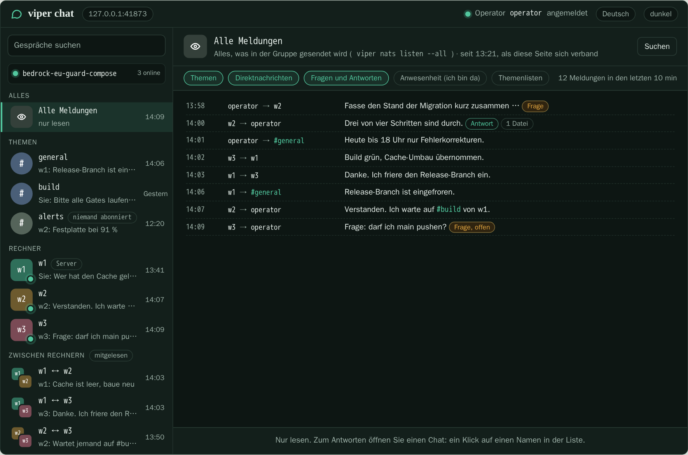
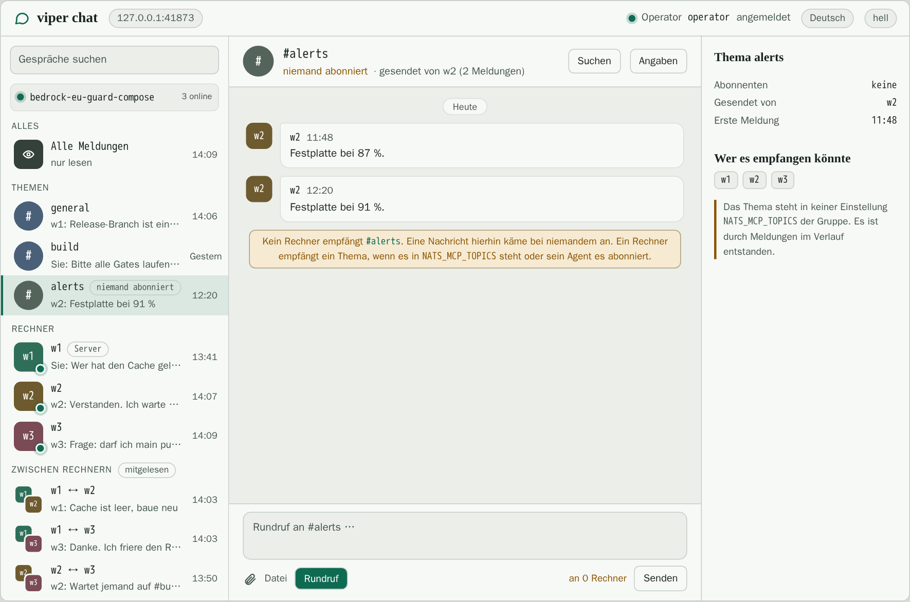
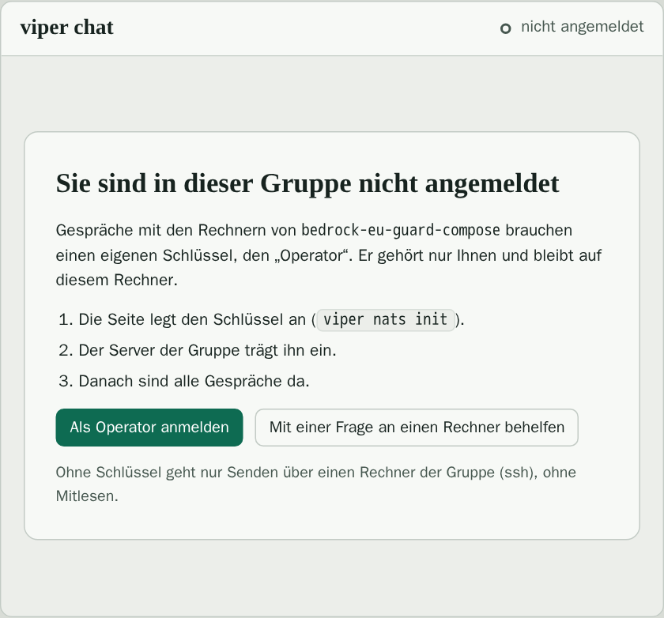
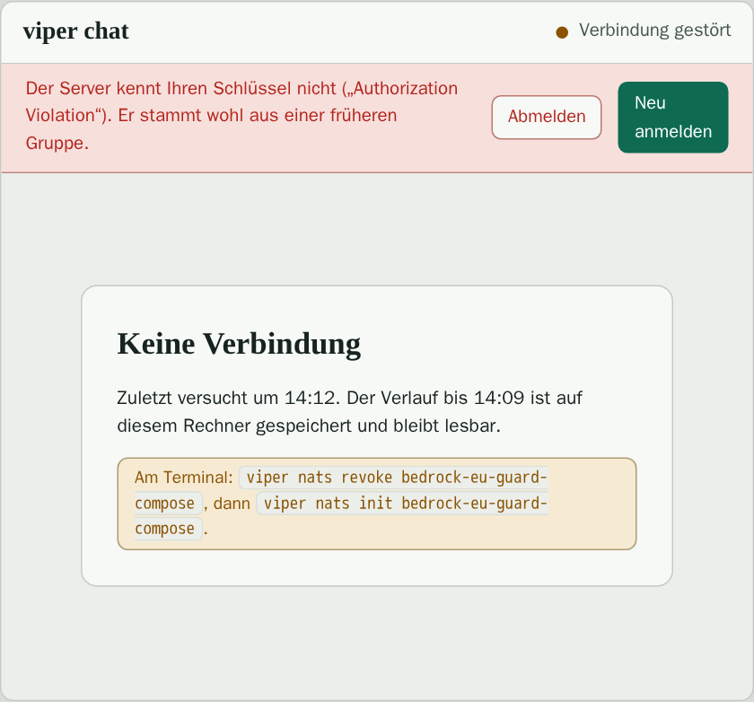
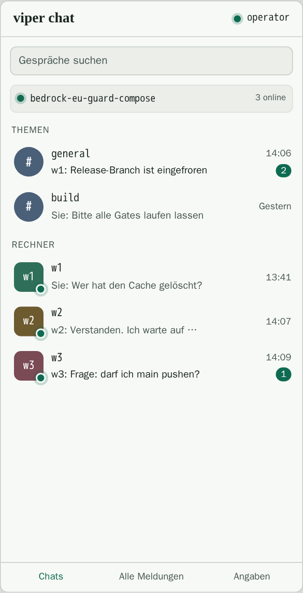

# Plan: Ein Chat für die NATS-Gruppen (`viper ui-chat`)

**Ziel:** `viper ui-chat` öffnet im Browser einen Chat im Stil von Microsoft Teams: links alle Gespräche, in der Mitte der Verlauf, unten das Eingabefeld. Jede Verbindung, die `viper` in einer NATS-Gruppe sieht, ist ein eigenes Gespräch: ein Rechner (Sie und er), **jedes Thema** der Gruppe, **jedes Paar von Rechnern** (w1 ↔ w2, mitgelesen) und „Alle Meldungen“ der Gruppe. Man schreibt Nachrichten, stellt Fragen und tauscht Dateien, ohne am Terminal `viper nats send` zu tippen.

**Stand:** Entwurf (18.11.2026); die Entscheidungen in §9 sind getroffen (Vorschläge übernommen), die Prüfung läuft (§10). Die Bilder in §6 sind eine **Vorschau zum Beurteilen** (HTML in [`ui-chat/vorschau.html`](ui-chat/vorschau.html)); gebaut ist nichts. Gehört zu [`nats.md`](nats.md) (die Gruppen), [`nats-cli.md`](nats-cli.md) (`viper nats`) und [`ui.md`](ui.md) (Sicherheit und Aufbau der Oberfläche). *[V]* heißt: im Code gelesen; *[?]* ist eine Vermutung, die vor dem Bauen zu prüfen ist.

## 1 Ausgangslage

* `viper nats` kann alles, was ein Chat braucht *[V]*: `send` (an einen Rechner), `broadcast` (an ein Thema), `request` (fragen und auf die Antwort warten), `listen [--topic T] [--all]` (mitlesen), `peers` und `topics` (wer da ist, wer was empfängt), `fetch` (eine Datei holen), `init` und `revoke` (der eigene Schlüssel als „operator“). Mit `--json` kommt jede Meldung als eine Zeile: `event`, `from`, `to`, `via` (`out`, `pub`, `presence`, `topics`), `topic`, `type` (`msg`, `req`), `id`, `re`, `text`, `att_*`.
* Die Seite NATS in `viper ui` zeigt das schon, aber als Werkzeug: ein Formular, ein Ausgabebereich, ein Mitlesen **je Lauf**, kein Verlauf. Wer mit mehreren Rechnern „spricht“, hat keinen Überblick, was er wem geschrieben hat und wer geantwortet hat.
* **Der Operator darf die ganze Gruppe lesen** *[V: `natsmcp/service.go`, `subscribeTopics`; `config.go`: „Der Server lässt jeden Rechner die Gruppe lesen, das ist kein neues Recht“]*: Das Mitlesen (`listen`) abonniert `viper.<gruppe>.*.pub.>`, also **alle Themen**, auch die, die kein Rechner empfängt; mit `--all` kommen die Direktnachrichten **zwischen allen Rechnern** dazu (`AllOutSub`). Daraus lassen sich die Gespräche zwischen zwei Rechnern und die Liste aller Themen bilden.
* **NATS (ohne JetStream) hebt nichts auf** *[V]*: Eine Meldung kommt nur an, wenn der Empfänger **in dem Moment** verbunden ist. Es gibt keinen Verlauf, keine Lesebestätigung, kein Bearbeiten und kein Löschen. Der Verlauf eines Chats muss also **auf diesem Rechner** entstehen, aus dem, was der Chat gesehen hat.
* Anwesenheit: Ein Rechner mit laufender Claude-Code-Sitzung sagt alle 30 Sekunden „ich bin da“; als da gilt er 90 Sekunden *[V]*. Rechner mit älterer Fassung melden nichts: unbekannt, nicht „weg“.
* Der Text einer Nachricht ist bis 16 KiB lang, eine Datei (PDF, Bild, ZIP) bis `NATS_OBJECTS_FILE_MAX` der Gruppe, in der Oberfläche höchstens 64 MiB *[V]*. Der Absender ist der Operator, wenn dieser Rechner einen Schlüssel hat (`viper nats init`), sonst ein Rechner der Gruppe über ssh *[V]*.
* Landet eine Nachricht bei einem Rechner, dessen `NATS_MCP_PUSH_FROM` den Absender nennt, **erscheint der Text dort als Eingabe in der Sitzung des Agenten**. `viper nats send` verlangt dann `--yes` *[V]*. Der Chat muss das sichtbar machen.
* Der Text einer Nachricht stammt von einem anderen Agenten: **nicht vertrauenswürdig** *[V]* (`natsmcp.Clean`, Schwärzung der Zugangsdaten, nie als HTML).

## 2 Grundregeln

1. **Ein Gespräch ist eine Verbindung.** Es gibt genau diese Arten: **Rechner** (Sie und ein Rechner: `send`/`request` an ihn, seine Antworten und alles, was er an den Operator schickt), **Thema** (`broadcast` und alles, was auf dem Thema gesendet wird; **jedes** Thema der Gruppe, auch eines, das niemand abonniert hat), **Paar** (zwei Rechner, **mitgelesen**: was `w1` und `w2` einander schreiben, nur lesen, Bild 3b) und **Alle Meldungen** (der ganze Strom der Gruppe, nur lesen). Rechner, die in keiner NATS-Gruppe stehen, haben keinen Chat; die Seite sagt es (§8).
2. **Der Chat erfindet keine Fähigkeit, die NATS nicht hat.** Keine Lesebestätigung, kein „tippt gerade“, kein Bearbeiten, kein Löschen, kein Nachladen von Meldungen, die vor dem Start gesendet wurden. Was fehlt, steht dort, wo man es sonst vermisst (die Zeile im Thema, Bild 2).
3. **Alles, was angezeigt wird, ist Text eines Fremden.** Nur `textContent`, kein HTML, keine automatischen Links, Dateien nie in der Seite, sondern als Download.
4. **Sicherheit wie `viper ui`** (§5): ein Port auf `127.0.0.1`, ein Schlüssel für den Start, `POST` mit Wache, CSP ohne Inline-Skript.
5. **Der Verlauf gehört dem Benutzer und bleibt auf diesem Rechner**: Datei mit Rechten `0600`, mit Grenzen für Alter und Größe, mit einem Knopf zum Löschen; bekannte Zugangsdaten werden geschwärzt, bevor etwas gespeichert wird.
6. **Wiederverwenden, nicht neu bauen:** Starten, Senden, Antworten und Holen von Dateien laufen über `viper nats …` (als Programm mit Argumentliste, wie die Seiten NATS), der Chat ist der Verlauf und die Oberfläche darüber (§3).

## 3 Aufbau

```
 Browser (Seite des Chats)                viper ui-chat (ein Programm, ein Port)
 ───────────────────────────             ────────────────────────────────────────────────────────
  Liste der Gespräche   ◄──── SSE ────   Strom je Gruppe:  viper nats listen G --all --json ──► NATS
  Verlauf, Eingabe      ──── POST ───►   Senden:           viper nats send|broadcast|request …
                                          Verlauf:          ~/.local/state/viper/chat/<gruppe>/…
                                          Abgleich:         Antwort ↔ Frage über "re" und "id"
```

* **Ein neuer Unterbefehl `viper ui-chat`** (`--port`, `--no-open`, `--readonly`), in `internal/adapter/driving/cli`. Er startet denselben Webserver wie `viper ui`, aber mit **anderen Seiten und einer anderen Programmschnittstelle** (`/api/chat/…`): Schlüssel, Cookie, Host- und Origin-Prüfung, CSP, Ströme und Läufe sind dieselben Bausteine *[V, zu prüfen: `web.Config` bekommt ein Feld für die Seiten und einen Handler; §9 Punkt 1]*. Der Chat hat **kein** Formular für Einstellungen, Läufe auf Rechnern oder Befehle.
* **Strom:** Für jede **verbundene** Gruppe läuft **ein** `viper nats listen G --all --json` als Lauf des Servers (kein Lauf je Tab). Seine Zeilen gehen durch dieselbe Reinigung und Schwärzung wie jeder Lauf, werden **einem Gespräch zugeordnet** und im Verlauf abgelegt; die Seite bekommt sie über SSE. Reißt der Strom ab (Tunnel, Server neu gestartet), verbindet der Server sich wieder (Wartezeit wächst bis 30 s) und sagt es im Kopf der Seite (Bild 5).
* **Zuordnung** *[V, aus den Feldern der Zeile]*: `via=out` mit `to=operator` oder `from=operator` → Gespräch des Rechners (`from`/`to`); `via=out` zwischen **zwei Rechnern** (nur mit `--all`) → das **Paar** (der Schlüssel des Paares sind die beiden Namen, sortiert: `w1`, `w2`, gleich in beiden Richtungen; Fragen und Antworten über `id` und `re`); `via=pub` → Thema `topic` (jedes, auch ohne Abonnent); `via=presence`/`topics` → Anwesenheit und Themenlisten, keine Nachricht (§4.4). Alles erscheint zusätzlich in „Alle Meldungen“.
* **Die Liste der Themen** besteht aus den Themen in `NATS_MCP_TOPICS` der Rechner (`viper nats topics`), den Themen, die Rechner als abonniert melden (`via=topics`), und den Themen, die im Strom vorkommen. Ein Thema ohne Abonnent trägt die Marke „niemand abonniert“ (Bild 3c).
* **Senden:** `viper nats send G TEXT --to M`, `broadcast G --topic T`, `request G --to M --timeout 30` (ein Lauf je Nachricht, mit Budget wie bei den Läufen der Seiten). **Der Text geht nie in die Befehlszeile**, sondern über eine Datei des Laufs (`--file`, wie bei der Seite NATS) *[V]*. Eine Datei kommt aus dem Hochladen (`--pdf|--image|--zip`). Die Nachricht steht **sofort** im Verlauf (Zustand „wird gesendet“), das Ergebnis des Laufs macht daraus „gesendet“ oder einen Fehler mit Grund.
* **Frage:** Der Lauf `request` wartet auf die Antwort; sie kommt auch als Zeile im Strom (`re` nennt die `id` der Frage). Der Chat zeigt die Antwort **unter der Frage** („Antwort nach 2 min 12 s“) und markiert eine unbeantwortete Frage; eine Antwort nach dem Ablauf der Wartezeit erscheint trotzdem im Gespräch.
* **Operator:** Ohne Schlüssel (`viper nats init`) gibt es **keinen Chat** (Bild 5, links): Strom und Verlauf brauchen ihn. Die Seite bietet **Anmelden** und **Abmelden** an (dieselben Läufe wie die Seite NATS). Kennt der Server den Schlüssel nicht („Authorization Violation“), steht der Weg da (Bild 5, rechts; seit v0.32.0 nennt `viper nats` den Grund).
* **Adapter:** Der Verlauf ist ein neuer Port `chat.Store` (gesehen, gesendet, gelesen, suchen, löschen) mit einer Datei als Adapter; die Zuordnung ist reine Logik in einem Anwendungsfall `chat` (Tests ohne Netz, §7).

### 3.1 Der Verlauf

* Eine Datei je Gespräch: `~/.local/state/viper/chat/<gruppe>/<gespräch>.jsonl` (`rechner-<name>`, `thema-<name>`, `paar-<a>-<b>` mit sortierten Namen; Name geprüft, kein Pfad aus Text), Rechte `0600`, Ordner `0700`. **Ein Gespräch entsteht erst mit der ersten Meldung** (bei zehn Rechnern gibt es sonst 45 leere Paare); höchstens 200 Gespräche je Gruppe, danach fallen die ältesten ohne Meldung weg. Jede Zeile: Zeit, Richtung, `from`/`to`, Text (geschwärzt und gereinigt), `id`, `re`, Art (`msg`, `req`, `answer`), Anhang (nur ID, Name, Art, Größe und Prüfsumme, **nicht** der Inhalt).
* **Grenzen:** höchstens 10 000 Zeilen und 20 MiB je Gespräch, nicht älter als 90 Tage (einstellbar mit Optionen von `viper ui-chat`); beim Überschreiten fallen die ältesten weg. Eine Zeile über 32 KiB wird gekürzt.
* **Gelesen:** je Gespräch die zuletzt gesehene Nummer; daraus die Zahl der ungelesenen (Bild 1, grüne Zahl). Ungelesen heißt „kam an, als diese Seite offen war oder später geladen wurde“.
* **Löschen:** „Verlauf löschen“ je Gespräch und für alles; die Dateien werden entfernt. Das Programm schreibt in `events.log` eine Zeile („chat: Verlauf von w2 gelöscht“), nie den Inhalt.
* **Was fehlt:** Meldungen, die ankamen, als `viper ui-chat` nicht lief, sind **nicht da** (NATS hat sie nicht aufgehoben). Das steht im Kopf jedes Themas (Bild 2) und im Handbuch. Wer Aufbewahrung braucht, braucht JetStream (Plan [`nats-jetstream-nuntius.md`](nats-jetstream-nuntius.md)); das ist nicht Teil dieses Plans.

### 3.2 Anwesenheit, Ungelesenes, Benachrichtigung

* **Lampe** je Rechner: grün = in den letzten 90 s gemeldet; **hohl** = älter; **keine Lampe** = meldet nichts (ältere Fassung). Die Kopfzeile des Gesprächs sagt „zuletzt vor 12 s“.
* **Ungelesen:** Zahl an der Zeile, Zahl im Titel des Tabs („(3) viper chat“).
* **Benachrichtigung des Browsers:** standardmäßig aus; ein Schalter fragt die Erlaubnis **erst bei einem Klick** *[V: so verlangt es der Browser]*. Der Text der Benachrichtigung ist **nur der Absender und „neue Nachricht“** (kein Inhalt eines Fremden auf dem Bildschirm außerhalb der Seite).
* **Suche:** über den Verlauf auf dem Server (Teilwort, ohne Unterschied der Groß- und Kleinschreibung), höchstens 200 Treffer, mit dem Gespräch.

## 4 Die Oberfläche

### 4.1 Aufbau der Seite

Dieselbe Gestalt wie `viper ui` ([`ui-gestaltung.md`](ui-gestaltung.md)): viper-Grün für „da“ und „fertig“, Bernstein für „wartet“ (eine offene Frage), Backstein für Fehler; Namen und Kennungen in Festbreite, Überschriften mit Serife; hell und dunkel; Deutsch und Englisch. Drei Spalten: **Gespräche** (296 px), **Verlauf**, auf Wunsch **Angaben** (270 px). Unter 900 px zeigt die Seite **eine** Spalte und einen Knopf „Zurück“ (Bild 6).

### 4.2 Die Gespräche

* **Kopf der Liste:** das Suchfeld und die **Gruppe** (Name, Zahl der Rechner, die da sind). Mit mehreren Gruppen steht jede als eigener Abschnitt; eine, die nicht verbunden ist, sagt es („dev: nicht verbunden“, Knopf **Verbinden**).
* **Abschnitte:** **Alles** („Alle Meldungen“, nur lesen), **Themen** (**alle**, auch die ohne Abonnent, mit Marke), **Rechner** (alle der Gruppe, auch die, die nicht da sind), **Zwischen Rechnern** (die Paare mit Meldungen, Marke „mitgelesen“, zwei kleine Kürzel statt eines). Sortiert nach der letzten Meldung; Ungelesenes steht fett.
* Ein Rechner, der ein **Server** der Gruppe ist, trägt die Marke „Server“.

### 4.3 Der Verlauf

* **Nachrichten** als Blasen: eigene rechts (grün getönt), fremde links mit dem Kürzel des Rechners. In einem **Paar** (Bild 3b) gibt es keine „eigenen“: der erste Rechner steht links, der zweite rechts (beide in der Farbe der Fremden), darunter die Zeile „Nur lesen. Schreiben können Sie an einen der beiden“ mit je einem Knopf zum Chat mit w1 und mit w2. In einem **Thema ohne Abonnent** (Bild 3c) warnt die Seite, bevor man schreibt: „an 0 Rechner“, die Nachricht käme bei niemandem an (der Knopf bleibt, denn das Thema kann bald jemand abonnieren). Kopf der Blase: Absender, Zeit, Marken **Frage** (bernsteinfarben, wartet), **Antwort nach …** (grün), **gesendet an N** (bei einem Thema), **Fehler** (Backstein, mit Grund).
* **Code:** Zeilen zwischen drei Gravis werden als Block gezeigt (nur Text, Festbreite). Sonst gibt es **keine** Formatierung und **keine** Links.
* **Dateien:** eine Karte (Art, Name, Größe, Prüfsumme) mit **Herunterladen**. Der Download holt die Datei mit `viper nats fetch` (nur mit dem Schlüssel des Operators) und liefert sie **immer als Download** mit `Content-Disposition: attachment` und `nosniff`; die Seite zeigt nie ein Bild, ein PDF oder ein ZIP selbst an (Bild 1).
* **Hinweise des Systems** (gestrichelt oder bernsteinfarben): „w2 liest Nachrichten von operator sofort in seiner Sitzung (`NATS_MCP_PUSH_FROM`)“ — **vor der ersten Nachricht** an so einen Rechner eine Rückfrage („Verstanden, senden“, entspricht `--yes`); „Nachrichten vor Ihrem Start sind nicht zu sehen“ (Thema).

### 4.4 Alle Meldungen

Nur lesen (Bild 3): eine Zeile je Meldung (Zeit, **von → an**, Text), auch was die Rechner einander schreiben. **Filter** als Schalter: Themen, Direktnachrichten, Fragen und Antworten, **Anwesenheit** (ich bin da, standardmäßig **aus**), Themenlisten (aus). Das ist die Antwort auf den Wunsch, den Heartbeat beim Mitlesen auszublenden (`viper nats listen --no-presence`, v0.32.0); hier ist er ein Schalter.

### 4.5 Eingabe

* Ein Textfeld (bis 16 384 Zeichen mit Zähler), **Strg+Enter** sendet, **Enter** macht eine neue Zeile. Der Entwurf je Gespräch bleibt im Browser (`localStorage`, wie die Wahl der Sprache), solange die Seite offen ist.
* **Art:** *Nachricht* (kommt an, wenn der Rechner da ist; keine Antwort nötig) oder *Frage* (wartet 30 s, bis 600 s einstellbar). Ein **Thema** kennt nur den Rundruf („an 2 Rechner“; die Zahl kommt aus den Themen, die die Rechner melden).
* **Datei:** Büroklammer, Ablegen auf den Verlauf oder **Strg+V** (auch ein Bildschirmfoto); eine Datei je Nachricht; die Seite prüft Art und Größe **vor** dem Senden (Bild 4). Eine Gruppe ohne Objektspeicher (`NATS_OBJECTS=true` fehlt) sperrt das Feld und sagt warum.
* **Nur lesen** (`viper ui-chat --readonly`): kein Eingabefeld, kein Anmelden, kein Löschen.

## 5 Sicherheit

Wie in [`ui.md` §3](ui.md), dazu:

| Maßnahme | gegen |
|---|---|
| Server nur auf `127.0.0.1`, Host-Kopf genau `127.0.0.1:<port>`, Schlüssel für den Start, Cookie `HttpOnly` und `SameSite=Strict`, `POST` mit `X-Viper-UI`, Prüfung von `Origin`, CSP `script-src 'self'` ohne Inline-Skript | eine fremde Seite im Browser, ein anderer Benutzer des Rechners |
| Alles aus NATS: `natsmcp.Clean`, Schwärzung bekannter Zugangsdaten, `textContent`, keine Links, Dateinamen gereinigt, Dateien nur als Download | ein Agent, der Text oder Dateien als Waffe schickt (HTML, Escape-Folgen, ein Link, ein „.pdf“ mit Skript) |
| Ein Strom je Gruppe, höchstens N Zeilen je Sekunde in die Seite, Zeilen über 32 KiB gekürzt, Grenzen des Verlaufs (§3.1) | eine Flut von Meldungen, die die Platte oder den Browser füllt |
| Der Text einer Nachricht geht **nie** in eine Befehlszeile, Namen kommen aus der Liste, `--name=wert`, kein Name mit `-` am Anfang | Einschleusen von Optionen |
| Verlauf mit `0600` in einem Ordner `0700`; keine Datei außerhalb von `chat/`; Dateinamen nur aus geprüften Namen | Lesen durch andere, Pfade aus Fremdtext |
| Rückfrage vor der ersten Nachricht an einen Rechner mit `NATS_MCP_PUSH_FROM` auf den Operator | Text, der ungewollt als Eingabe in einer Sitzung eines Agenten landet |
| Die Gespräche zwischen Rechnern sind klar als **mitgelesen** gekennzeichnet, nur lesen, ohne Eingabefeld; `--no-pairs` schaltet sie ab (§9 Punkt 10) | das Gefühl, privat zu sein, und das Lesen von Nachrichten, die nicht für den Operator bestimmt sind (erlaubt, weil jeder Rechner der Gruppe es darf, aber sichtbar) |
| `viper ui-chat` als `root` warnt; mit `--readonly` nur Ansehen | versehentliches Senden |

**Kein TLS auf dem Port, kein Speichern von Schlüsseln im Browser** (wie bei `viper ui`). Der Verlauf kann Geheimnisse enthalten, die kein bekannter Name tragen: Er liegt nur lokal, hat Grenzen und lässt sich löschen; das Handbuch sagt es.

## 6 Vorschau (Bilder)

Die Bilder zeigen die Oberfläche mit Beispielen (Gruppe `bedrock-eu-guard-compose`, Rechner `w1` bis `w3`). Quelle: [`ui-chat/vorschau.html`](ui-chat/vorschau.html), im Browser zu öffnen.

**1 Direktchat mit einem Rechner** (Frage, Antwort mit Datei, Hinweis auf `NATS_MCP_PUSH_FROM`, Angaben rechts):


**2 Ein Thema** (Rundruf; wer es empfängt; was NATS nicht aufhebt):


**3 Alle Meldungen, dunkel** (nur lesen, Filter, Anwesenheit aus):



**3b Gespräch zwischen zwei Rechnern** (mitgelesen, nur lesen; links die Paare):


**3c Ein Thema, das niemand abonniert hat** (die Marke, die Warnung, „an 0 Rechner“):



**4 Datei senden** (Ablegen, Prüfung der Größe vor dem Senden):


**5 Wenn etwas fehlt** (nicht angemeldet; der Server kennt den Schlüssel nicht):





**6 Schmales Fenster** (Liste, Gespräch):

 

## 7 Meilensteine und Tests

| | Inhalt | Prüfung |
|---|---|---|
| 0 | **Verifikation:** Läuft `viper nats listen --all --json` stundenlang (Tunnel, Wiederverbinden, Speicher)? Sind `id` und `re` in den Zeilen vollständig genug für die Zuordnung (auch bei `request`)? Was kommt bei Rechnern ohne Anwesenheit? Wie viele Meldungen schafft der Strom je Sekunde? | echte Gruppe (`compose`, lokal), Messung, Ergebnis in diesen Plan |
| 1 | **Gerüst:** `viper ui-chat`, Seiten und Schnittstelle des Chats im Webserver, Operator-Zustand (Bild 5), Liste der Gespräche aus `Overview.NATS` und `topics` | Go-Tests der Schnittstelle, Browser-Test (Liste, Leerzustand), axe hell/dunkel/de/en |
| 2 | **Verlauf und Strom:** Anwendungsfall `chat` (Zuordnung inklusive **Paar** und **alle Themen**, Frage und Antwort), Port `chat.Store` und Datei, Strom je Gruppe, Wiederverbinden, Lesen in Seite (Bild 1 bis 3 ohne Senden) | Tabellentests der Zuordnung mit echten Zeilen, Tests des Verlaufs (Grenzen, Rechte, Löschen), e2e mit einem **Fake**, der Zeilen liefert |
| 3 | **Senden:** Nachricht, Rundruf, Frage; Zustand „wird gesendet“, Fehler; die Rückfrage bei `NATS_MCP_PUSH_FROM` | e2e mit dem **echten `viper`** und einem Fake-`ssh` (die Befehlszeile ist die richtige und kennt keine falsche Option; Lehre aus v0.26.0) |
| 4 | **Dateien:** Senden (Ablegen, Strg+V, Prüfung), Herunterladen | Tests der Grenzen, Download-Kopfzeilen, Bild 4 |
| 5 | **Anwesenheit, Ungelesenes, Suche, Benachrichtigung** | Tabellentests, e2e |
| 6 | **Feinschliff:** schmale Breite, Tastatur, Sprache, Größe der Seiten (Grenze §9 Punkt 8) | axe, Tastaturtest, Größentest |
| 7 | **Handbuch** (Kapitel zum Chat, Befehlstabelle, die Grenzen von NATS), README, Hilfe, Plan-Stand | Durchsicht, unabhängige Prüfung |

Nach jedem Meilenstein: unabhängige Prüfung, wie bei `viper ui`. Der Chat braucht **keine** neuen Rechte auf den Rechnern: alles läuft über die Befehle, die es gibt.

## 8 Nicht Teil dieses Plans

* **Aufbewahrung auf den Rechnern** (JetStream): Der Chat sieht nur, was ankam, solange er lief.
* **Lesebestätigungen, „tippt gerade“, Reaktionen, Antworten in Fäden, Bearbeiten, Löschen auf der Gegenseite, Anrufe, Besprechungen:** gibt NATS nicht her.
* **Mehrere Benutzer:** Der Chat gehört dem einen Operator dieses Rechners.
* **Gespräche mit Rechnern ohne NATS-Gruppe** (etwa per ssh): kein Chat. Die Seite zeigt sie nicht; ein Hinweis nennt den Weg (`viper ui`, die Seite „Befehl“).
* **Rechner ändern, starten, löschen:** das bleibt `viper ui`.

## 9 Entscheidungen

Der Benutzer hat am 18.11.2026 **alle Vorschläge übernommen**. Was jetzt gilt:

1. **Eigener Unterbefehl `viper ui-chat` mit eigenem Port** (derselbe Webserver mit anderen Seiten); kein Reiter in `viper ui`.
2. **Verlauf auf der Platte**, mit den Grenzen und dem Löschen aus §3.1.
3. **Operator ist Pflicht** (Anmelden auf der Seite); kein Senden über einen Rechner ohne Schlüssel.
4. **Formatierung:** nur Code-Blöcke, keine Links.
5. **Benachrichtigung des Browsers:** aus, einschaltbar, ohne Inhalt der Nachricht.
6. **Name:** `viper ui-chat`.
7. **Frage:** Wartezeit 30 s, einstellbar bis 600 s; eine spätere Antwort erscheint trotzdem im Gespräch.
8. **Größe der Seiten:** eigene Grenze von 175 KB für den Start, Texte je Sprache nachgeladen (wie bei `viper ui`).
9. **Mehrere Gruppen** in einem Fenster, jede mit eigenem Strom, höchstens vier zugleich.
10. **Paare** (Rechner ↔ Rechner) standardmäßig **sichtbar**; `--no-pairs` schaltet sie ab.
11. **Verlauf beim Abmelden** (`viper nats revoke`): wird **behalten**, die Seite fragt, ob er gelöscht werden soll.

## 10 Prüfung

Noch nicht geprüft. Vorgesehen: ein unabhängiger Prüfer liest den Plan gegen den Code und das gebaute Programm (Zeilen von `listen --json`, `id` und `re`, Verhalten bei Abbruch des Tunnels), bevor Meilenstein 1 beginnt.
