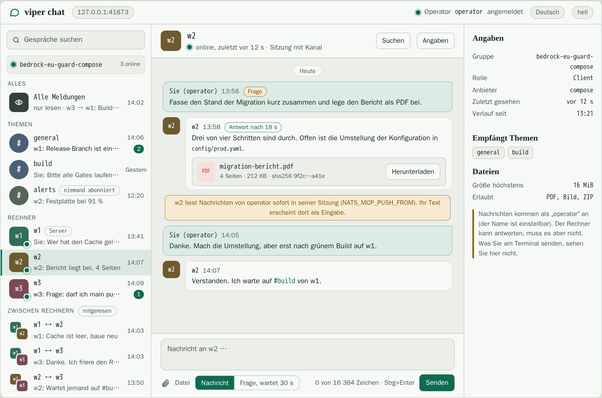
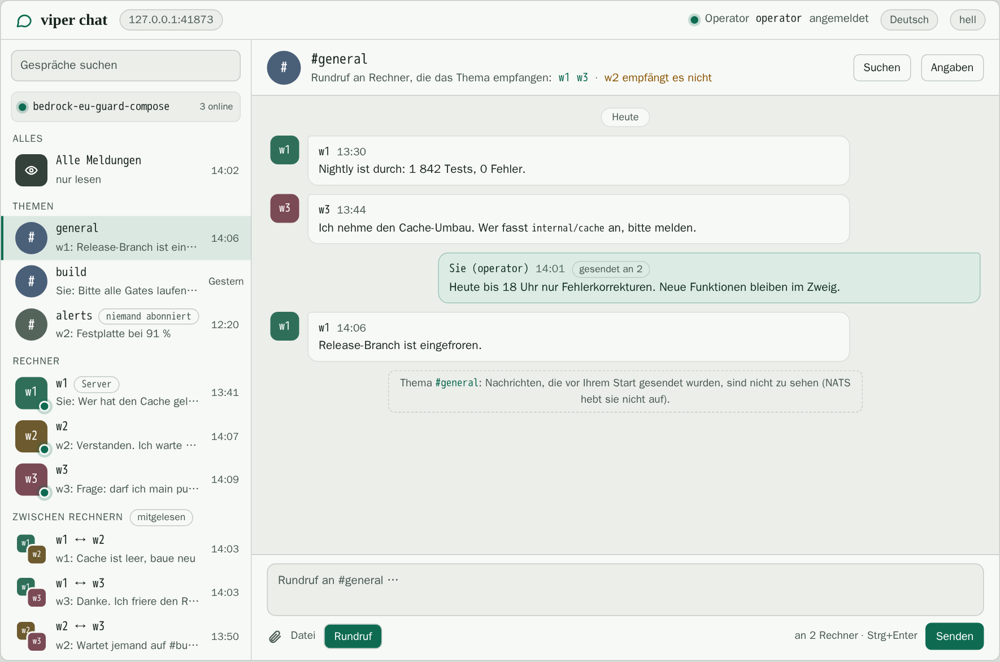
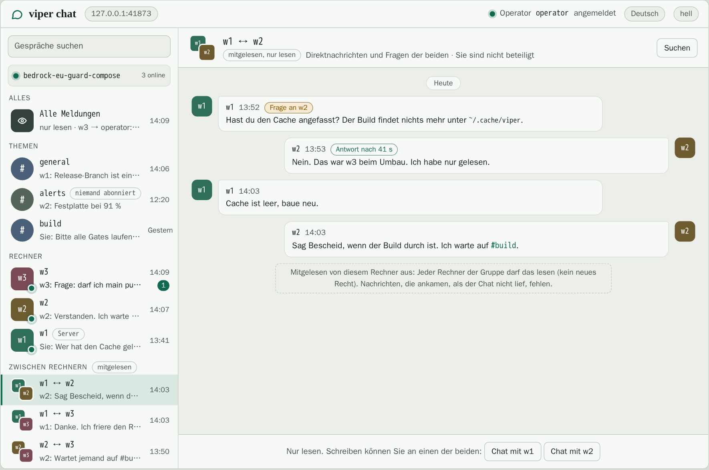
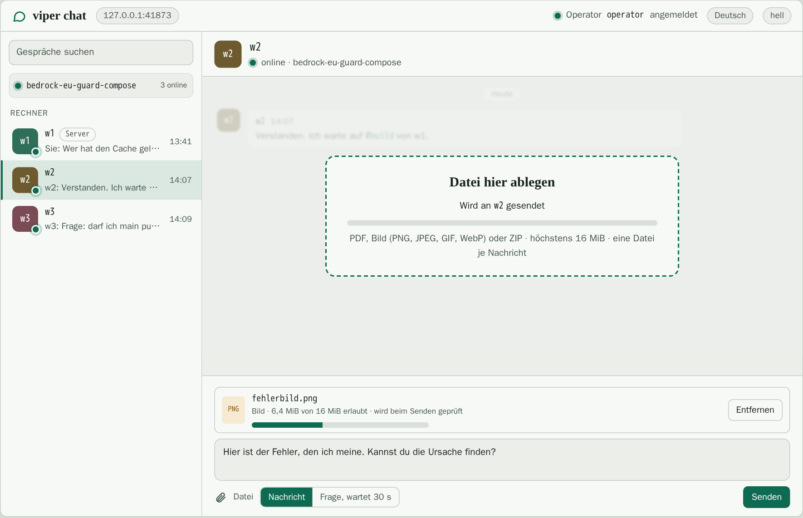
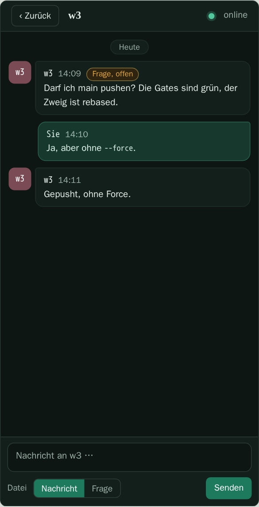

# Plan: Ein Chat für die NATS-Gruppen (`viper ui-chat`)

**Ziel:** `viper ui-chat` öffnet im Browser einen Chat im Stil von Microsoft Teams: links alle Gespräche, in der Mitte der Verlauf, unten das Eingabefeld. Jede Verbindung, die `viper` in einer NATS-Gruppe sieht, ist ein eigenes Gespräch: ein Rechner (Sie und er), **jedes Thema** der Gruppe, **jedes Paar von Rechnern** (w1 ↔ w2, mitgelesen) und „Alle Meldungen“ der Gruppe. Man schreibt Nachrichten, stellt Fragen und tauscht Dateien, ohne am Terminal `viper nats send` zu tippen.

**Stand:** Entwurf (18.11.2026); die Entscheidungen in §9 sind getroffen (Vorschläge übernommen); der Plan wurde einmal unabhängig gegen den Code und ein gebautes Programm geprüft, die Funde sind eingearbeitet (§10); eine zweite Prüfung ist eingearbeitet (§10.1); Meilenstein 0 (Verifikation) ist gemacht (§7.1). Die Bilder in §6 sind eine **Vorschau zum Beurteilen** (HTML in [`ui-chat/vorschau.html`](ui-chat/vorschau.html)); gebaut ist nichts. Gehört zu [`nats.md`](nats.md) (die Gruppen), [`nats-cli.md`](nats-cli.md) (`viper nats`) und [`ui.md`](ui.md) (Sicherheit und Aufbau der Oberfläche). *[V]* heißt: im Code gelesen; *[?]* ist eine Vermutung, die vor dem Bauen zu prüfen ist.

## 1 Ausgangslage

* `viper nats` kann alles, was ein Chat braucht *[V]*: `send` (an einen Rechner), `broadcast` (an ein Thema), `request` (fragen und auf die Antwort warten), `listen [--topic T] [--all]` (mitlesen), `peers` und `topics` (wer da ist, wer was empfängt), `fetch` (eine Datei holen), `init` und `revoke` (der eigene Schlüssel als „operator“). Mit `--json` kommt jede Meldung als eine Zeile: `event`, `from`, `to`, `via` (`out`, `pub`, `presence`, `topics`), `topic`, `type` (`msg`, `req`, `res`), `id` (nur bei `req`), `re` (nur bei `res`), `text`, `att_*`. Der Operator sieht **seine eigenen Nachrichten nicht** (`NoEcho`).
* Die Seite NATS in `viper ui` zeigt das schon, aber als Werkzeug: ein Formular, ein Ausgabebereich, ein Mitlesen **je Lauf**, kein Verlauf. Wer mit mehreren Rechnern „spricht“, hat keinen Überblick, was er wem geschrieben hat und wer geantwortet hat.
* **Der Operator darf die ganze Gruppe lesen** *[V: `natsmcp/service.go`, `subscribeTopics`; `config.go`: „Der Server lässt jeden Rechner die Gruppe lesen, das ist kein neues Recht“]*: Das Mitlesen (`listen`) abonniert `viper.<gruppe>.*.pub.>`, also **alle Themen**, auch die, die kein Rechner empfängt; mit `--all` kommen die Direktnachrichten **zwischen allen Rechnern** dazu (`AllOutSub`). Daraus lassen sich die Gespräche zwischen zwei Rechnern und die Liste aller Themen bilden.
* **NATS (ohne JetStream) hebt nichts auf** *[V]*: Eine Meldung kommt nur an, wenn der Empfänger **in dem Moment** verbunden ist. Es gibt keinen Verlauf, keine Lesebestätigung, kein Bearbeiten und kein Löschen. Der Verlauf eines Chats muss also **auf diesem Rechner** entstehen, aus dem, was der Chat gesehen hat.
* Anwesenheit: Ein Rechner mit laufender Claude-Code-Sitzung sagt alle 30 Sekunden „ich bin da“; als da gilt er 90 Sekunden *[V]*. Rechner mit älterer Fassung melden nichts: unbekannt, nicht „weg“.
* Der Text einer Nachricht ist bis 16 KiB lang, eine Datei (PDF, Bild, ZIP) bis `NATS_OBJECTS_FILE_MAX` der Gruppe, in der Oberfläche höchstens 64 MiB *[V]*. Der Absender ist der Operator, wenn dieser Rechner einen Schlüssel hat (`viper nats init`), sonst ein Rechner der Gruppe über ssh *[V]*.
* Landet eine Nachricht bei einem Rechner, dessen `NATS_MCP_PUSH_FROM` den Absender nennt, **erscheint der Text dort als Eingabe in der Sitzung des Agenten**. `viper nats send` verlangt dann `--yes` *[V]*. Der Chat muss das sichtbar machen.
* Der Text einer Nachricht stammt von einem anderen Agenten: **nicht vertrauenswürdig** *[V]* (`natsmcp.Clean`, Schwärzung der Zugangsdaten, nie als HTML).

## 2 Grundregeln

1. **Ein Gespräch ist eine Verbindung.** Es gibt genau diese Arten: **Rechner** (Sie und ein Rechner: `send`/`request` an ihn, seine Antworten und alles, was er an den Operator schickt), **Thema** (`broadcast` und alles, was auf dem Thema gesendet wird; **jedes** Thema der Gruppe, auch eines, das niemand abonniert hat), **Paar** (zwei Rechner, **mitgelesen**: was `w1` und `w2` einander schreiben, nur lesen, Bild 3b) und **Alle Meldungen** (der ganze Strom der Gruppe, nur lesen). Rechner, die in keiner NATS-Gruppe stehen, haben keinen Chat; die Seite sagt es (§8).
2. **Der Chat erfindet keine Fähigkeit, die NATS nicht hat.** Keine Lesebestätigung, kein „tippt gerade“, kein Bearbeiten, kein Löschen, kein Nachladen von Meldungen, die vor dem Start gesendet wurden. Was fehlt, steht dort, wo man es sonst vermisst (die Zeile im Thema, Bild 2).
3. **Alles, was angezeigt wird, ist Text eines Fremden.** Nur `textContent`, kein HTML, keine automatischen Links, Dateien nie in der Seite, sondern als Download.
4. **Sicherheit wie `viper ui`** (§5): ein Port auf `127.0.0.1`, ein Schlüssel für den Start, `POST` mit Wache, CSP ohne Inline-Skript.
5. **Der Verlauf gehört dem Benutzer und bleibt auf diesem Rechner**: Datei mit Rechten `0600`, mit Grenzen für Alter und Größe, mit einem Knopf zum Löschen; bekannte Zugangsdaten werden geschwärzt, bevor etwas gespeichert wird.
6. **Wiederverwenden, nicht neu bauen:** Starten, Senden, Antworten und Holen von Dateien laufen über **dieselben Funktionen wie `viper nats`** (`natsmcp.RunCLI` über einen Tunnel, den `openOperator` öffnet), im Programm und nicht als Kindprozess (§3). Der Chat ist der Verlauf und die Oberfläche darüber.

## 3 Aufbau

```
 Browser (Seite des Chats)         viper ui-chat (ein Programm, ein Port)
 ─────────────────────────        ───────────────────────────────────────────────────────────────────
  Liste der Gespräche   ◄─ SSE ─   Chat-Schicht (Paket cli):  je Gruppe  openOperator (ein Tunnel)
  Verlauf, Eingabe      ─ POST ─►   ├─ Strom:     natsmcp.RunCLI("watch", --all, --query) ─► NATS
                                    ├─ Senden:    RunCLI("send" | "broadcast" | "request") über denselben Tunnel
                                    ├─ Holen:     RunCLI("fetch") bei einem Klick
                                    └─ Verlauf:   ~/.local/state/viper/chat/<gruppe>/…  (Sperrdatei)
```

* **Ein neuer Unterbefehl `viper ui-chat`** (`--port`, `--no-open`, `--readonly`, `--no-pairs`, `--keep-days N`, `--no-history`), in `internal/adapter/driving/cli`. Er startet denselben Webserver wie `viper ui`, aber mit **eigenen Seiten und eigener Programmschnittstelle** (`/api/chat/…`, §3.3).
* **Der Strom läuft im Programm, nicht als Lauf des Servers** *(Ergebnis der Prüfung, 18.11.2026)*. Ein Dauerlauf in der Lauf-Tabelle von `viper ui` passt nicht: Das Budget der NATS-Läufe ist vier (`maxRuns`), vier Gruppen belegten es ganz und `send` ginge nicht mehr; die Tabelle behält nur 1 MiB Ausgabe, schneidet Zeilen nach 4096 Byte oder 600 ms Stille (eine Nachricht bis 16 KiB wird als JSON bis 33 KiB mehrfach zerlegt), mischt stdout und stderr und schwärzt auf der **JSON-Zeile**: ein Geheimnis mit `"`, `\`, `<`, `>`, `&` steht dort maskiert und würde nicht gefunden. Darum: **die Chat-Schicht ruft `openOperator` einmal je Gruppe** (ein ssh-Tunnel, einmal `Find`: zwei ssh-Aufrufe, bis 20 s) und danach `natsmcp.RunCLI` mit **eigenem `io.Writer`**, zeilenweise gelesen (ein Scanner mit 256 KiB je Zeile, wie `ReadEvents`). `send`, `request` und `fetch` laufen über **denselben** Tunnel (sonst zahlt jede Nachricht Tunnel und Anmeldung neu). `openOperator` ist heute nicht exportiert; die Chat-Schicht liegt darum im Paket `cli`, und `web` bekommt nur Schnittstellen (§3.3).
* **Schwärzen und Reinigen nach dem Dekodieren:** Jede Zeile wird als JSON gelesen; `Clean` und `Redact` laufen auf `text` und `att_name`, nicht auf der Zeile.
* **Der Strom** ist `watch --all --query` (mit `--query` fragen die Rechner beim Start nach Anwesenheit: sonst stünde jedes Thema die ersten bis zu 30 s falsch auf „niemand abonniert“; der Operator zählt danach kurz als anwesend, bei jedem Neustart des Stroms). **`watch` schreibt `{"event":"ready"}`, sobald die Verbindung steht** *[V, Versuch: nach 2 ms]*; nur `viper nats listen` gibt es nicht weiter. „Verbunden“ heißt also: `ready` ist da. Ein **Wächter** erkennt einen toten Strom: Stirbt der Tunnel, schreibt `watch` nichts auf stdout; erkennbar ist es an stderr (`disconnected`, `server error`, `reconnected`), am Prozess des Tunnels und an einer Probe des lokalen Tunnelports (der ssh-Tunnel endet von selbst nach höchstens etwa 60 s: `ServerAliveInterval 15` mal 4). **Nicht** „90 s ohne Anwesenheitszeile“: eine Gruppe ohne offene Sitzung schweigt stundenlang, der Wächter verbände sonst dauernd neu. Bei einem toten Strom: neu verbinden (neuer Tunnel; jeder Versuch ruft `Find`, also ssh; Wartezeit 2 s, verdoppelt bis 30 s, das ist die Wartezeit des Chats, die von NATS ist fest 2 s). **Bei „Authorization Violation“ wird nicht automatisch neu verbunden**, sondern erst nach „Neu anmelden“ (Bild 5b). Der Kopf der Seite sagt „Verbindung gestört, nächster Versuch in 8 s“.
* **`--readonly`:** Der Strom läuft (Lesen ist erlaubt); Senden, Anmelden, Abmelden und Löschen sind gesperrt. (In `viper ui` ist `listen` bei `--readonly` ein Lauf und damit gesperrt; im Chat gibt es keinen Lauf.)
* **Zuordnung** *[V, Felder der Zeile]*: Die Zeilen haben `event` (`message`), `from`, `to`, `via` (`out`, `pub`, `presence`, `topics`), `topic`, `type` (**`msg`, `req`, `res`**, `presence`, `topics`; `caps` kommt nie im Strom an), `id` (nur `req`), `re` (nur `res`), `state` (bei Anwesenheit auch `bye`), `text`, `att_*`. `via=out` mit `to=operator` oder `from=operator` → Gespräch des Rechners; `via=out` zwischen **zwei Rechnern** (nur mit `--all`) → das **Paar** (Schlüssel: die beiden Namen, sortiert); `via=pub` → Thema `topic` (jedes, auch ohne Abonnent; der Versuch zeigte: `w3 → pub.zzz` steht im Strom); `via=presence`/`topics` → Anwesenheit und Themenlisten, keine Nachricht (`bye` macht „weg“ sofort sichtbar). Alles erscheint zusätzlich in „Alle Meldungen“.
* **Die Liste der Themen:** `NATS_MCP_TOPICS` der Rechner (`reportConfiguredTopics`), die Themen, die Rechner als abonniert melden (`via=topics`, `text` mit Leerzeichen getrennt), und die Themen im Strom. „Niemand abonniert“ gilt erst, wenn **alle** Rechner der Gruppe einmal Anwesenheit gemeldet haben (bis dahin „unbekannt“); die Zahl „an N Rechner“ ist eine **Schätzung** aus diesen Meldungen und heißt „an 2 Rechner, die das Thema melden“, nie „zugestellt“.
* **Eigene Nachrichten kommen nicht im Strom an** *[V: `NoEcho`, und `Parse`/`ParseDirect` verwerfen `Me`; im Versuch bestätigt]*: Was der Operator sendet, trägt der Chat **selbst** in den Verlauf ein (Gespräch des Rechners, Thema und „Alle Meldungen“). Nachrichten des Operators, die von einem **Terminal** (`viper nats send`) oder von der Seite NATS in `viper ui` kommen, sind für den Chat **unsichtbar**; das steht im Handbuch.
* **Senden:** `send`, `broadcast`, `request` als `RunCLI`-Aufruf; der Text geht **nie** in eine Befehlszeile (im Programm gibt es keine; der Text wird als Wert übergeben). `sent` heißt nur „an den Server gegeben“ (`FlushTimeout`), nie „angekommen“; der Chat sagt „gesendet“, nicht „zugestellt“. Das Limit des Textes ist **16 384 Byte** (nicht Zeichen), auf dem Draht zusätzlich 32 KiB nach der JSON-Kodierung (ein Steuerzeichen zählt 6 Byte, ein `"` 2): der Zähler zählt Bytes und warnt vor 32 KiB. `remote` umgeht `Validate` und `Words` der Befehlszeile: **Namen und Optionen prüft der Chat selbst** (`ValidName`, Liste der Rechner). Jeder Aufruf verbindet neu mit NATS (mehrere Verbindungen mit einem Schlüssel sind erlaubt), und `settle` wartet 200 ms: ein Senden dauert mindestens etwa 0,2 s, darum der Zustand „wird gesendet“. Eine Datei zu senden fragt vorher einmal nach Anwesenheit (alle Rechner antworten mit Anwesenheit, Themen und `caps`: ein kurzer Schub im Strom).
* **Frage und Antwort:** `request` wartet **höchstens 120 s** (nicht 600: das Programm lehnt mehr ab; die Prüfung des Servers in `viper ui` erlaubt 600, sie wird nicht übernommen). Die `id` der eigenen Frage wird in `askWith` erzeugt und nirgends ausgegeben; darum bekommt `request` **eine Option `--announce`, die nur der Chat setzt**: Mit ihr schreibt es vor dem Warten ein Ereignis `asked` mit der `id` (dafür gibt `askWith` die `id` über einen Rückruf heraus). **Ohne die Option bleibt alles wie heute:** `checkEvent` in `usecase/natscli` lehnt jedes unbekannte `event` ab, `viper nats request` (im Programm, per ssh zu einem Rechner mit älterem `viper-nats-mcp`, auf der Seite NATS) bräche sonst. So gibt es **keine Versionsverschiebung** (§3, Versionen). **Die Antwort kommt zweimal** an: als Ereignis `answer` (ohne `to` und ohne Anhang) und als Zeile `res` im Strom (mit `to`, `att_*`, etwa 550 ms später); der Chat nimmt die **Zeile des Stroms** als Nachricht (sie ist vollständiger) und nutzt `answer` nur, um die wartende Frage zu schließen. **Dedupe nach (`re`, `from`).** Eine späte Antwort (nach dem Ablauf) erscheint nur im Strom und wird über `re` der Frage zugeordnet. Eine Antwort gilt nur, wenn `from` der Gefragte ist und `to` der Fragende (der Dienst eines Rechners prüft das; ein Rechner kann ein `res` mit fremdem `re` senden, der Chat prüft es selbst).
* **Antworten auf die Frage eines Rechners:** Fragt ein Rechner den Operator (`type=req` an `to=operator`, mit `id`), ist die Frage im Gespräch **offen** („Frage, offen“, Bild 3, Bild 6b) und hat einen Knopf **Antworten**. Dafür fehlt heute ein Unterbefehl: `send` erzeugt immer eine `msg`, und der wartende Rechner nimmt nur ein `res` mit passendem `re` von dem an, den er fragte. Neu: **`reply --to M --re ID TEXT`** in `natsmcp` (derselbe Umschlag `res`, den der Dienst der Rechner schon annimmt, **keine Änderung auf den Rechnern**, nur der Operator braucht das neue Programm; es läuft im Programm des Chats, nicht per ssh).
* **Operator:** Ohne Schlüssel (`viper nats init`) gibt es **keinen Chat** (Bild 5a). Die Seite bietet **Anmelden** und **Abmelden** an (dieselben Abläufe wie die Seite NATS; Anmelden geht per ssh zum Server und braucht Zeit: Zustand „läuft“, Fehler mit Grund). Kennt der Server den Schlüssel nicht („Authorization Violation“), steht der Weg da (Bild 5b; `connectOnce` nennt den Grund seit v0.32.0; ein **laufender** Strom hat den Hinweis nicht: der Wächter liest ihn aus stderr). **Der Name des Operators ist einstellbar** (`NATS_OPERATOR_NAME`, Standard `operator`): Texte und Zuordnung nehmen ihn aus der Gruppe, nie fest „operator“.
* **`NATS_MCP_PUSH_FROM`:** Die Prüfung und `--yes` gibt es nur im Weg über einen Rechner (`natsPushCheck`); **als Operator braucht `send` nie `--yes`**. Der Chat baut die Rückfrage **selbst** aus `NATS_MCP_PUSH_FROM` jedes Rechners (`loadNatsGroup` hat die Daten: Operator, `MCPPushFrom`, Themen, `objectsFileMax`). Sie gilt für **Rechner und für Themen**: ein Rundruf wird bei jedem Rechner in den Sitzungs-Text geschoben, der das Thema empfängt und den Operator in `NATS_MCP_PUSH_FROM` führt (`maybePush`); die Rückfrage nennt diese Rechner und kommt **einmal je Rechner oder Thema und Seite** (nach dem Neuladen wieder). Der Operator selbst darf in `NATS_MCP_PUSH_FROM` stehen; Rechner ohne den Operator dort fragen nicht.
* **Versionen:** Der Chat liest den Strom (`watch`), den jede Fassung kennt, und ruft `request --announce` und `reply` **im selben Programm** auf; die Programme auf den Rechnern (`viper-nats-mcp`) bleiben unverändert und können älter sein. Verschoben wäre nur der Weg über ssh zu einem Rechner, den der Chat nicht geht (§9 Punkt 3).
* **Adapter:** Der Verlauf ist ein Port `chat.Store` (gesehen, gesendet, gelesen, suchen, löschen) mit einer Datei als Adapter; die Zuordnung (Gespräche, Paare, Fragen, Dedupe) ist reine Logik in einem Anwendungsfall `chat` (Tests ohne Netz, §7).

### 3.1 Der Verlauf

* **Zeit:** Es gibt **keinen Zeitstempel des Absenders** (weder in `Envelope` noch in der Zeile). Jede Meldung trägt die **Ankunftszeit beim Chat**: nicht fälschbar, aber nicht die Absendezeit; die Reihenfolge verschiedener Absender ist die Ankunftsfolge; nach einem Neustart des Stroms gibt es Lücken. Der **Absender** ist dagegen durch das Subject belegt (der Server lehnt ein gefälschtes `from` ab: im Versuch „Permissions Violation“).
* **Dateien:** Eine Datei je Gespräch unter `model.StateDir(home)/chat/<gruppe>/` (dieselbe Funktion wie für die anderen Zustandsdateien; sie liefert auf jedem System `<home>/.local/state/viper`): `rechner__<name>.jsonl`, `thema__<name>.jsonl`, `paar__<a>__<b>.jsonl` (sortiert). Die Namen dürfen Bindestriche haben, aber **keinen Unterstrich**, darum trennt `__` eindeutig (`paar-a-b-c` wäre mehrdeutig: (`a`, `b-c`) gegen (`a-b`, `c`)). Das Alphabet (`a-z`, `0-9`, `-`) schließt Pfadzeichen aus; Rechte `0600`, Ordner `0700`. **Ein Gespräch entsteht erst mit der ersten Meldung.**
* **Grenzen:** höchstens **500 Gespräche** je Gruppe (§ Namen oben); je Gespräch **zwei Dateien** (`….jsonl`, `….1.jsonl`), die erste wird bei **5 000 Zeilen oder 10 MiB** zur zweiten (die alte zweite fällt weg): also höchstens 10 000 Zeilen und 20 MiB je Gespräch. Eine Gesamtgrenze von **1 GiB je Gruppe**: darüber fällt zuerst die älteste Datei `.1`. **Alter:** Eine Datei, deren neueste Zeile älter als 90 Tage ist (`--keep-days`), wird gelöscht, und beim Lesen werden ältere Zeilen übersprungen (die Rotation in Blöcken hält sonst alte Zeilen). Unter **Windows** wird die Datei vor dem Umbenennen geschlossen. Eine Zeile über 32 KiB wird gekürzt. **Suche:** ohne Index über die Dateien (höchstens 200 Treffer); bei vielen Gesprächen kann sie dauern, die Seite sagt „sucht …“.
* **Zeile:** eine **laufende Nummer `n`** (je Gruppe, wächst nur, wird mit gespeichert und ändert sich bei der Rotation nicht; die Seite nutzt sie als `Last-Event-ID` für den Strom und das Nachladen nach Tab-Schlaf oder Netzabriss, und für „gelesen“), die **Ankunftszeit in UTC** (die Seite zeigt sie in der Zeitzone des Browsers; „Heute“ und „Gestern“ rechnet der Browser), Richtung, `from`/`to`, Text (gereinigt und geschwärzt), `id`, `re`, Art (`msg`, `req`, `res`), Anhang (nur ID, Name, Art, Größe, Prüfsumme).
* **Nur Meldungen werden gespeichert**, nicht die Anwesenheit und nicht die Themenlisten (das ist Zustand im Speicher: bei 50 Rechnern wären es 144 000 Zeilen am Tag); „Alle Meldungen“ hat **eine eigene Datei** `alle.jsonl` mit denselben Grenzen.
* **Namen:** Ein Gespräch eines Rechners oder ein Paar entsteht **nur für Namen aus der Liste der Rechner der Gruppe**. Ein Rechner darf auf `viper.<g>.<er>.>` beliebig veröffentlichen, also auch `out.<erfundener-name>`: Solche Meldungen erscheinen **nur in „Alle Meldungen“**, mit dem Hinweis „an unbekannten Namen“. Ein neues **Thema** entsteht aus jedem Namen, aber höchstens 100 je Stunde je Absender; darüber hinaus geht es nur in „Alle Meldungen“. **Eine Flut löscht keinen Verlauf:** Über der Grenze von 500 Gesprächen entstehen keine neuen Themen (der Hinweis steht in der Seite); gelöscht wird nur nach Alter und Größe.
* **Sperre:** Zwei `viper ui-chat` zugleich schrieben dieselben Dateien doppelt (NATS erlaubt zwei Verbindungen mit einem Schlüssel). Darum eine Sperrdatei `chat/.lock`. **`internal/filelock` kann das heute nicht:** `Lock` blockiert (`LOCK_EX` ohne `LOCK_NB`, unter Windows `LockFileEx` ohne `FAIL_IMMEDIATELY`) und gibt nichts zurück, woraus ein Port zu lesen wäre. Neu: **`TryLock`** (Unix und Windows) und eine zweite Datei `chat/.port` mit dem Port des laufenden Programms; der zweite Start sagt „läuft schon (Port N)“ und endet. Eine veraltete Sperre nach einem Absturz gibt es nicht (der Kernel gibt `flock` und `LockFileEx` beim Prozessende frei; die Dateien erben ssh und Kinder nicht).
* **Gelesen** (letzte gesehene Nummer je Gespräch), **Löschen** (je Gespräch und alles; eine Zeile in `events.log` ohne Inhalt) und **Abmelden** (Verlauf bleibt, die Seite fragt) wie zuvor.
* **Was fehlt:** Meldungen, die ankamen, als `viper ui-chat` nicht lief, oder in einer Lücke des Stroms; Meldungen, die `Decode` als zu groß oder fehlerhaft verwirft (nur eine Zeile auf stderr, der Chat zählt sie: „3 Meldungen verworfen“); eigene Meldungen vom Terminal (§3). Wer Aufbewahrung braucht, braucht JetStream ([`nats-jetstream-nuntius.md`](nats-jetstream-nuntius.md)); das ist nicht Teil dieses Plans.

### 3.2 Anwesenheit, Ungelesenes, Benachrichtigung, Grenzen

* **Lampe** je Rechner: **grün** = in den letzten 90 s „ich bin da“; **hohl** = zuletzt gesehen vor mehr als 90 s oder `bye`; **keine Lampe** = noch nie gesehen („unbekannt“; das kann ein Rechner ohne Sitzung oder mit älterer Fassung sein, der Strom unterscheidet das nicht). Die Kopfzeile sagt „zuletzt vor 12 s“. Die Marke **Server** kommt aus `Find` beim Start (`openOperator` kennt den Server der Gruppe), nicht aus dem Strom.
* **Ungelesen:** Zahl an der Zeile, Zahl im Titel des Tabs („(3) viper chat“). **Benachrichtigung des Browsers:** aus; ein Schalter fragt die Erlaubnis erst bei einem Klick; der Text ist nur „neue Nachricht von w2“, nie der Inhalt. **Suche:** über den Verlauf auf dem Server, Teilwort, höchstens 200 Treffer.
* **Rate:** Der Chat nimmt höchstens **200 Zeilen je Sekunde** insgesamt und **50 je Absender** an (Annahmen; in Meilenstein 0 zu messen); der Rest wird gezählt und verworfen („12 Meldungen verworfen: w3 sendet zu viel“). **Der Writer des Stroms darf nie blockieren:** Die Rückrufe der Verbindung laufen unter dem Schloss von `lockedLines`, ein langsamer Writer führte zu „slow consumer“. Er legt die Zeilen in eine **begrenzte Warteschlange** (bei voller Schlange wird gezählt und verworfen); Verlauf, Schwärzung und SSE arbeiten in einer anderen Goroutine. Dasselbe gilt für die SSE zum Browser.
* **Start:** Zuerst wird der **Verlauf gelesen** (er ist auch ohne Verbindung da, auch wenn `Find` hängt), danach `Find` und der Tunnel. **`Find` hat kein Zeitlimit** und fragt die Rechner der Reihe nach (kein `ConnectTimeout`): Ein nicht erreichbarer Rechner vor dem Server kann bis zum TCP-Zeitlimit dauern; die „bis 20 s“ gelten nur für den Tunnel. Die Seite zeigt „verbindet …“. Der Tunnel gehört dem **Kontext der Gruppe**, nicht dem einer Anfrage (`openOperator` bindet ihn an den übergebenen Kontext). Bei SIGKILL bleiben der Ordner `viper-nats-*` mit `ca.pem` und der ssh-Prozess zurück (das Programm räumt beim Start auf, was ihm gehört: Muster und Alter).
* **Windows und macOS:** Die Sperrdatei und die Dateinamen (Kleinbuchstaben, `__`) sind unkritisch; zu prüfen sind der Pfad des Zustands, der Tunnel als Kindprozess (`ssh -N -L`, Abbruch) und die Benachrichtigung (nur nach Klick).

### 3.3 Verdrahtung im Webserver

Der Chat braucht mehr als ein Feld in `web.Config` *(Prüfung)*. **Wichtig:** `Handler()` registriert heute fest `/api/run`, `/api/check`, `/api/edit/*`, `/api/upload` und weitere. Ein Chat, der nur zusätzliche Handler bekäme, trüge **die ganze Programmschnittstelle von `viper ui`** mit: Der Schlüssel des Chats könnte `viper up` und `down` starten. Darum bekommt `web.Config` einen **Betrieb** („ui“ oder „chat“): Im Chat werden **nur** die Routen des Chats und die der Sitzung (Schlüssel, Cookie, Stand) eingetragen; ein Test prüft, dass `/api/run`, `/api/edit/*`, `/api/check` und die anderen im Chat **404** liefern.

* **`Config.Site fs.FS`** (Standard `pages()`), ein Haken für zusätzliche Handler, und der Pfad der Ströme (`/api/events` ist fest im Wächter, der Ströme zählt: ein SSE des Chats würde einen der 16 allgemeinen Plätze belegen) sowie der Pfad des Uploads (`/api/upload`, `application/octet-stream`) werden **einstellbar**. CSP, Cookie (`viper_ui_<port>`) und Prüfungen bleiben unverändert. Ein Kernpaket für das Gemeinsame ist **nicht** nötig.
* **Eigene Seiten in einem eigenen Paket** (`internal/adapter/driving/chatweb/static`, eigenes `embed`): `TestThePagesHaveNothingThatTheModelForbids` (feste Dateiliste), `TestThePagesStaySmall` (175 KB Start, 200 KB gesamt) und der Schlüsseltest hängen an `web.Pages()`; der Chat bekommt **eigene Tests** mit `fs.FS` als Parameter und **eigene Grenzen**. Heute hat `viper ui` 157 385 Byte beim Start (21,8 KB bis 175 KB): ein gemeinsames Budget gäbe es nicht. `style.css` (die Farben) wird **kopiert**, nicht geteilt.
* **Das Backend** (`uiBackend.natsGroups`, `web.NATSGroup`) beschreibt heute nur Name, Rechner, „Operator da“ und `FileMax`. Der Chat braucht zusätzlich je Gruppe den **Namen des Operators** (`NATS_OPERATOR_NAME`) und je Rechner **`NATS_MCP_PUSH_FROM`**, die abonnierten Themen der Einstellungen und die Größe der Datei (`min(FileMax, 64 MiB)`).
* **Downloads** hängen nicht an der Lauf-Tabelle (sie vergisst nach 20 beendeten Läufen und löscht deren Dateien): Der Chat hat einen **eigenen Cache** (Schlüssel: Anlagen-ID und Prüfsumme, Datei im Verzeichnis `0700`, Lebensdauer 30 Minuten, höchstens 256 MiB) und liefert mit `Content-Disposition: attachment`, einem gereinigten Namen (`cleanFileName`, nicht der Name aus der Meldung) und `nosniff`.

## 4 Die Oberfläche

### 4.1 Aufbau der Seite

Dieselbe Gestalt wie `viper ui` ([`ui-gestaltung.md`](ui-gestaltung.md)): viper-Grün für „da“ und „fertig“, Bernstein für „wartet“ (eine offene Frage), Backstein für Fehler; Namen und Kennungen in Festbreite, Überschriften mit Serife; hell und dunkel; Deutsch und Englisch. Drei Spalten: **Gespräche** (296 px), **Verlauf**, auf Wunsch **Angaben** (270 px). Unter 900 px zeigt die Seite **eine** Spalte und einen Knopf „Zurück“ (Bild 6).

### 4.2 Die Gespräche

* **Kopf der Liste:** das Suchfeld und die **Gruppe** (Name, Zahl der Rechner, die da sind). Mit mehreren Gruppen steht jede als eigener Abschnitt; eine, die nicht verbunden ist, sagt es („dev: nicht verbunden“, Knopf **Verbinden**).
* **Abschnitte:** **Alles** („Alle Meldungen“, nur lesen), **Themen** (**alle**, auch die ohne Abonnent, mit Marke), **Rechner** (alle der Gruppe, auch die, die nicht da sind), **Zwischen Rechnern** (die Paare mit Meldungen, Marke „mitgelesen“, zwei kleine Kürzel statt eines). Sortiert nach der letzten Meldung; Ungelesenes steht fett.
* Ein Rechner, der ein **Server** der Gruppe ist, trägt die Marke „Server“ (die Quelle ist `Find` beim Start, nicht der Strom, §3.2).

### 4.3 Der Verlauf

* **Nachrichten** als Blasen: eigene rechts (grün getönt), fremde links mit dem Kürzel des Rechners. In einem **Paar** (Bild 3b) gibt es keine „eigenen“: der erste Rechner steht links, der zweite rechts (beide in der Farbe der Fremden), darunter die Zeile „Nur lesen. Schreiben können Sie an einen der beiden“ mit je einem Knopf zum Chat mit w1 und mit w2. In einem **Thema ohne Abonnent** (Bild 3c) warnt die Seite, bevor man schreibt: „an 0 Rechner“, die Nachricht käme bei niemandem an (der Knopf bleibt, denn das Thema kann bald jemand abonnieren). Kopf der Blase: Absender, Zeit, Marken **Frage** (bernsteinfarben, wartet), **Frage, offen** (eine Frage **an** den Operator, mit Knopf **Antworten**), **Antwort nach …** (grün), **an N Rechner, die das Thema melden** (bei einem Thema), **Fehler** (Backstein, mit Grund).
* **Code:** Zeilen zwischen drei Gravis werden als Block gezeigt (nur Text, Festbreite). Sonst gibt es **keine** Formatierung und **keine** Links.
* **Dateien:** eine Karte (Art, Name, Größe, Prüfsumme) mit **Herunterladen**. Der Download holt die Datei mit `viper nats fetch` (nur mit dem Schlüssel des Operators) und liefert sie **immer als Download** mit `Content-Disposition: attachment` und `nosniff`; die Seite zeigt nie ein Bild, ein PDF oder ein ZIP selbst an (Bild 1).
* **Hinweise des Systems** (gestrichelt oder bernsteinfarben): „w2 liest Nachrichten von operator sofort in seiner Sitzung (`NATS_MCP_PUSH_FROM`)“ — **vor der ersten Nachricht** an so einen Rechner eine Rückfrage („Verstanden, senden“). Die Rückfrage baut der Chat selbst aus `NATS_MCP_PUSH_FROM` jedes Rechners; im Weg des Operators gibt es `--yes` nicht (§3); „Nachrichten vor Ihrem Start sind nicht zu sehen“ (Thema).

### 4.4 Alle Meldungen

Nur lesen (Bild 3): eine Zeile je Meldung (Zeit, **von → an**, Text), auch was die Rechner einander schreiben. **Filter** als Schalter: Themen, Direktnachrichten, Fragen und Antworten, **Anwesenheit** (ich bin da, standardmäßig **aus**), Themenlisten (aus). Das ist die Antwort auf den Wunsch, den Heartbeat beim Mitlesen auszublenden (`viper nats listen --no-presence`, v0.32.0); hier ist er ein Schalter.

### 4.5 Eingabe

* Ein Textfeld (bis 16 384 **Byte** mit Zähler in Bytes; auf dem Draht gelten zusätzlich 32 KiB nach der JSON-Kodierung), **Strg+Enter** sendet, **Enter** macht eine neue Zeile. Der Entwurf je Gespräch bleibt im Browser (`localStorage`, wie die Wahl der Sprache), solange die Seite offen ist.
* **Art:** *Nachricht* (kommt an, wenn der Rechner da ist; keine Antwort nötig) oder *Frage* (wartet 30 s, einstellbar bis **120 s**: länger lässt `request` nicht zu; eine spätere Antwort erscheint trotzdem im Gespräch). Ein **Thema** kennt nur den Rundruf („an 2 Rechner“; die Zahl kommt aus den Themen, die die Rechner melden).
* **Datei:** Büroklammer, Ablegen auf den Verlauf oder **Strg+V** (auch ein Bildschirmfoto); eine Datei je Nachricht; die Seite prüft Art und Größe **vor** dem Senden (Bild 4; die Grenze ist `min(NATS_OBJECTS_FILE_MAX der Gruppe, 64 MiB)`). Eine Gruppe ohne Objektspeicher (`NATS_OBJECTS=true` fehlt) sperrt das Feld und sagt warum.
* **Nur lesen** (`viper ui-chat --readonly`): kein Eingabefeld, kein Anmelden, kein Löschen.

### 4.6 Zugänglichkeit und Tabs

* **Liste:** `role="list"`/`listitem` oder `listbox` mit Pfeiltasten, `aria-current` am offenen Gespräch, die Zahl der Ungelesenen im Namen des Eintrags („w3, 1 ungelesen“), nicht nur als grüne Zahl; die Lampe hat ein Wort („online“, „zuletzt vor 3 min“, „unbekannt“).
* **Verlauf:** `role="log"` mit `aria-live="polite"` für neue Nachrichten (nicht für jede Zeile von „Alle Meldungen“: dort `aria-live="off"`); Fokus nach dem Senden im Eingabefeld, nach „Zurück“ (schmal) auf dem Eintrag der Liste; `prefers-reduced-motion` beachtet. Axe in Hell und Dunkel, Deutsch und Englisch, wie bei `viper ui`.
* **Mehrere Tabs:** Der Stand „gelesen“ liegt auf dem Server und gilt für beide; der **Entwurf** liegt im `sessionStorage` (je Tab, nicht gemeinsam); jeder Tab hat einen eigenen Strom (höchstens 8 Ströme, `maxStreams`).
* **Große Gruppen:** Bei 50 Rechnern gäbe es bis zu 1 225 Paare; es erscheinen nur die mit Meldungen (höchstens 500 Gespräche), die Liste zeichnet **nur die sichtbaren Zeilen** (Virtualisierung ab 200 Einträgen).
* **Verlauf im Klartext:** Die Dateien liegen im Zustandsverzeichnis, neben dem Schlüssel des Operators, und gehen mit einem Backup des Home-Verzeichnisses mit. Das Handbuch sagt es. Wechselt der Schlüssel (`revoke`/`init`), bleibt der Verlauf (er gehört zur Gruppe und zum Namen); ändert sich `NATS_OPERATOR_NAME`, bleibt der alte Name in den Zeilen (die Richtung ist mit gespeichert).

## 5 Sicherheit

Wie in [`ui.md` §3](ui.md), dazu:

| Maßnahme | gegen |
|---|---|
| Server nur auf `127.0.0.1`, Host-Kopf genau `127.0.0.1:<port>`, Schlüssel für den Start, Cookie `HttpOnly` und `SameSite=Strict`, `POST` mit `X-Viper-UI`, Prüfung von `Origin`, CSP `script-src 'self'` ohne Inline-Skript | eine fremde Seite im Browser, ein anderer Benutzer des Rechners |
| Alles aus NATS: `natsmcp.Clean`, Schwärzung bekannter Zugangsdaten, `textContent`, keine Links, Dateinamen gereinigt, Dateien nur als Download | ein Agent, der Text oder Dateien als Waffe schickt (HTML, Escape-Folgen, ein Link, ein „.pdf“ mit Skript) |
| Ein Strom je Gruppe, höchstens 200 Zeilen je Sekunde (50 je Absender, §3.2), Zeilen über 32 KiB gekürzt, Grenzen des Verlaufs (§3.1), höchstens 100 neue Themen je Stunde je Absender | eine Flut von Meldungen, die die Platte oder den Browser füllt |
| Kein Kindprozess mit Argumenten: Der Chat ruft die Funktionen im Programm auf; Namen kommen aus der Liste und aus `ValidName` (`a-z`, `0-9`, `-`), nie ein freier Pfad | Einschleusen von Optionen und Pfaden |
| Zeit nur als Ankunftszeit; der Absender ist durch das Subject belegt (der Server lehnt Fälschung ab); eine Antwort gilt nur von dem, den man fragte | gefälschte Absender, Zeiten und Antworten |
| Im Chat nur die Routen des Chats (Betrieb „chat“, 404 für `/api/run` und die übrigen) | der Schlüssel des Chats startet `viper up`/`down` |
| Gespräche und Paare nur für Namen aus der Gruppe; Fluten löschen keinen Verlauf | ein Rechner, der Gespräche erfindet und Verlauf verdrängt |
| Schwärzen **nach** dem Dekodieren des JSON, auf `text` und `att_name` | Geheimnisse mit `"`, `\`, `&`, `<` im JSON |
| Sperrdatei `chat/.lock`: ein `viper ui-chat` je Zustandsverzeichnis | doppelte Zeilen im Verlauf |
| Verlauf mit `0600` in einem Ordner `0700`; keine Datei außerhalb von `chat/`; Dateinamen nur aus geprüften Namen | Lesen durch andere, Pfade aus Fremdtext |
| Rückfrage vor der ersten Nachricht an einen Rechner mit `NATS_MCP_PUSH_FROM` auf den Operator | Text, der ungewollt als Eingabe in einer Sitzung eines Agenten landet |
| Die Gespräche zwischen Rechnern sind klar als **mitgelesen** gekennzeichnet, nur lesen, ohne Eingabefeld; `--no-pairs` schaltet sie ab (§9 Punkt 10) | das Gefühl, privat zu sein, und das Lesen von Nachrichten, die nicht für den Operator bestimmt sind (erlaubt, weil jeder Rechner der Gruppe es darf, aber sichtbar) |
| `viper ui-chat` als `root` warnt; mit `--readonly` nur Ansehen | versehentliches Senden |

**Kein TLS auf dem Port, kein Speichern von Schlüsseln im Browser** (wie bei `viper ui`). Der Verlauf kann Geheimnisse enthalten, die kein bekannter Name tragen: Er liegt nur lokal, hat Grenzen und lässt sich löschen; das Handbuch sagt es.

## 6 Vorschau (Bilder)

Die Bilder zeigen die Oberfläche mit Beispielen (Gruppe `bedrock-eu-guard-compose`, Rechner `w1` bis `w3`). Quelle: [`ui-chat/vorschau.html`](ui-chat/vorschau.html), im Browser zu öffnen.

**1 Direktchat mit einem Rechner** (Frage, Antwort mit Datei, Hinweis auf `NATS_MCP_PUSH_FROM`, Angaben rechts; die Angaben zeigen nur, was der Strom und `Find` kennen, keine MCP-Version):



**2 Ein Thema** (Rundruf; wer es empfängt; was NATS nicht aufhebt):



**3 Alle Meldungen, dunkel** (nur lesen, Filter, Anwesenheit aus):


**3b Gespräch zwischen zwei Rechnern** (mitgelesen, nur lesen; links die Paare):



**3c Ein Thema, das niemand abonniert hat** (die Marke, die Warnung, „an 0 Rechner“):


**4 Datei senden** (Ablegen, Prüfung der Größe vor dem Senden):



**5 Wenn etwas fehlt** (nicht angemeldet; der Server kennt den Schlüssel nicht):


**6 Schmales Fenster** (Liste, Gespräch):

 

## 7 Meilensteine und Tests

| | Inhalt | Prüfung |
|---|---|---|
| 0 | **Verifikation** (gemacht, Ergebnisse in §7.1) | Messungen am 18.11.2026 mit einem eingebetteten NATS-Server (Rechte des Operators), einem Tunnel als TCP-Proxy und einem echten `sshd` als Benutzer |
| 1 | **Gerüst** (gemacht, 18.11.2026): `viper ui-chat` (Optionen `--port`, `--no-open`, `--readonly`, `--no-pairs`, `--keep-days`, `--no-history`), `web.Config.Chat` (Seiten, Routen, Pfade der Ströme und Uploads; im Chat gibt es **nur** die Routen des Chats, ein Test prüft die 404 der übrigen), eigenes Paket `chatweb` mit eigenen Seiten und eigenen Tests (Dateien, Größe, Schlüssel der Sprachen), `TryLock` und die Sperre `chat/.lock` mit `.port`, `GET /api/chat/state` (Gruppen, Rechner, Themen der Einstellungen, Operator da oder nicht), Liste der Gespräche und Leerzustand (Bild 5a). **Verschoben:** der Kanal `done` des Tunnels (mit dem Wächter, Meilenstein 2), die Knöpfe Anmelden/Abmelden (Meilenstein 3: sie brauchen die Läufe), Anwesenheit, Verlauf und Paare (Meilenstein 2) | Go-Tests (Schnittstelle, Seiten, `TryLock`), Browser-Tests mit dem echten Programm (Liste, Leerzustand, Sprache, 404 der Routen von `viper ui`, zweiter Start, axe hell/dunkel/de/en) |
| 2 **Gebaut:** `usecase/chat` (Zuordnung, Anwesenheit, Grenzen, Engine mit Wiederverbinden 2 bis 30 s, Wächter für den toten Tunnel, Halt bei unbekanntem Schlüssel), Ports `chatlog` (Verlauf) und `chatstream` (Verbindung) und `driving.Chat`, Datei- und Speicher-Verlauf, `GET /api/chat/{conversations,messages,events}` und `POST /api/chat/read`, Seite mit Liste (Alle Meldungen, Themen auch ohne Abonnenten, Rechner, Paare), Fäden aus reinem Text (nur Codeblöcke), Ungelesen, Filter, Banner bei Störung. **Verschoben:** Suche, Löschen (Meilenstein 5) | **Verlauf und Strom** (gemacht und geprüft, 18.11.2026; die Funde sind eingearbeitet): Anwendungsfall `chat` (Zuordnung inklusive **Paar** und **alle Themen**, Frage und Antwort), Port `chat.Store` und Datei, Strom je Gruppe, Wiederverbinden, Lesen in Seite (Bild 1 bis 3 ohne Senden) | Tabellentests der Zuordnung mit echten Zeilen (**Dedupe** der Antwort, späte Antwort mit `asked`, Reihenfolge verschiedener Absender, Neustart des Stroms, Zeilen über 4096 Byte und 32 KiB, Flut, Schwärzung eines Geheimnisses mit `&` und `"`, Namenskollision der Paare, `--readonly` mit Strom, **toter Tunnel**, Neustart nach „Authorization Violation“), Tests des Verlaufs (Grenzen, Rechte, Löschen), e2e mit einem **Fake**, der Zeilen liefert |
| 3 | **Senden** (gemacht und geprüft, 18.11.2026; die Funde sind eingearbeitet)**:** Nachricht, Rundruf, Frage; Zustand „wird gesendet“, Fehler; die Rückfrage bei `NATS_MCP_PUSH_FROM`. **Gebaut:** `POST /api/chat/send` (prüft Art, Text bis 16 384 Byte, Rechner der Gruppe, Namen des Themas; `--readonly` sperrt; die Rückfrage verlangt der **Server** mit `409` und der Liste der Rechner, bis `ack` **alle** diese Rechner nennt (wächst die Menge, fragt er neu); eine Antwort braucht eine echte offene Frage im Verlauf; höchstens 8 Sendungen zugleich), `chatBackend.Send` (je Sendung ein Tunnel, `RunCLI` im Programm, Text als Eingabe, nie in einer Befehlszeile), Frage im Hintergrund mit `request --announce` (die `id` kommt sofort, das Ende des Wartens als Ereignis `ask_end`), neuer Unterbefehl `reply --to --re` in `natsmcp`, eigene Nachrichten gehen mit `Engine.Add` in den Verlauf (`Dir: out`) und zu den Seiten, Eingabefeld (Byte-Zähler, Strg+Enter, Entwurf je Gespräch, Art Nachricht/Frage mit Wartezeit, Antworten auf offene Fragen, Rückfrage „Verstanden, senden“). **Verschoben:** Anmelden/Abmelden auf der Seite (brauchen Läufe; weiter am Terminal mit `viper nats init`), Dateien (Meilenstein 4) | e2e mit dem **echten `viper`** und einem Fake-`ssh` (die Befehlszeile ist die richtige und kennt keine falsche Option; Lehre aus v0.26.0) |
| 4 | **Dateien** (gemacht und geprüft, 18.11.2026; die Funde sind eingearbeitet; **bekannte Grenze:** eine eigene **Frage** mit Datei hat keinen Download-Link, weil `request` die Datei nicht in `asked` meldet)**:** Senden (Büroklammer, Ablegen, Strg+V, Prüfung), Herunterladen. **Gebaut:** `POST /api/chat/upload` (Octet-Pfad; Größe `min(NATS_OBJECTS_FILE_MAX, 64 MiB)`, Art nach den ersten Bytes und `CheckAttachment` wie auf den Rechnern, gereinigter Name, höchstens 4 wartende Dateien je 10 Minuten, Ordner `0700` im Temp-Verzeichnis, beim Beenden gelöscht), `send` mit `file` (Text darf fehlen; keine Datei bei einer Antwort; die Datei geht nur einmal und bleibt bei der Rückfrage erhalten), Rahmen `AttachFrame` und `--attach` wie bei `viper nats`, die Zeile `sent` gibt Objekt-ID und Prüfsumme in den Verlauf; `GET /api/chat/file?group&conv&n` (nur Dateien, die eine Meldung des Verlaufs nennt; `fetch` einmal, Cache 30 Minuten und 256 MiB, immer `attachment`, `nosniff`, `application/octet-stream`, gereinigter Name); in der Seite Karte mit Herunterladen, Auswahl, Ablegen und Einfügen, Prüfung der Größe vor dem Senden, Hinweis bei Gruppe ohne Objektspeicher. **Nicht getestet:** das Senden und Holen einer echten Datei gegen einen Server mit JetStream im Chat-Weg (die Unterbefehle `--attach` und `fetch` sind in `natsmcp` getestet, der Chat ruft sie mit denselben Funktionen auf) | Tests der Grenzen, Download-Kopfzeilen, Bild 4 |
| 5 | **Anwesenheit, Ungelesenes, Suche, Benachrichtigung** (gemacht und geprüft, 18.11.2026; die Funde sind eingearbeitet). **Gebaut:** Lampe nur für gesehene Rechner (grün „da, gesehen vor N s“, hohl „weg“, ohne Lampe „noch nicht gesehen“), Name des Eintrags mit Anwesenheit und Zahl der Ungelesenen, Zahl im Titel des Tabs (ohne „Alle Meldungen“ doppelt zu zählen), Schalter für die Benachrichtigung (aus, fragt erst beim Klick, Text nur „neue Nachricht von w2“, nie der Inhalt, nicht für Paare und „Alle Meldungen“, nicht für das offene Gespräch bei sichtbarer Seite), `GET /api/chat/search` (Teilwort, ab 2 Zeichen, höchstens 200 Treffer, jeder einmal), `POST /api/chat/delete` (ein Gespräch oder die ganze Gruppe, mit Rückfrage, `--readonly` sperrt). **Nicht gebaut:** die Zeile in `events.log` beim Löschen | Tabellentests, e2e |
| 6 | **Feinschliff** (gemacht, 18.11.2026): Knopf „Zurück zur Liste“ bei schmaler Breite (Fokus auf den Eintrag), Pfeiltasten, Pos1 und Ende in der Liste, Esc leert die Suche, `aria-live=off` bei „Alle Meldungen“, Seiten 58 KB gegen die Grenze von 175 KB. **Nicht gebaut:** Filter „Anwesenheit“ und „Themenlisten“ in „Alle Meldungen“ (die Zeilen werden gar nicht gespeichert) | axe, Tastaturtest, Größentest |
| 7 | (gemacht, 18.11.2026; Prüfung steht aus) **Handbuch** (Kapitel zum Chat als **Ist-Zustand**, keine Chronik; Befehlstabelle neben `viper ui`; die Grenzen von NATS; „eigene Nachrichten vom Terminal sind unsichtbar“), README, Hilfe (`cli.go`, `help.go`), Plan-Stand | Durchsicht, unabhängige Prüfung |

Nach jedem Meilenstein: unabhängige Prüfung, wie bei `viper ui`. Der Chat braucht **keine** neuen Rechte auf den Rechnern: alles läuft über die Befehle, die es gibt.

### 7.1 Ergebnisse von Meilenstein 0 (18.11.2026)

Gemessen mit `natsmcp.RunCLI("watch", "--all")` im Programm (Go-Test, eingebetteter NATS-Server mit den echten Rechten, Absender als Rechner `a`), und mit einem echten `sshd` und `ssh -N -L` (Benutzerrechte, Port 22731, `ServerAliveInterval 2`, `ServerAliveCountMax 3`).

| Frage | Ergebnis |
|---|---|
| **Durchsatz des Stroms** | 5 000 Meldungen auf einem Thema, **keine verloren**: bei 100 Byte Nutzlast 82 700/s im Strom (gesendet 525 000/s), bei 2 000 Byte 21 200/s, bei 15 000 Byte **3 800/s**. Die Grenze von 200 Zeilen/s (50 je Absender) liegt **weit unter** dem, was der Strom schafft: sie schützt Verlauf, Platte und Browser, nicht die NATS-Verbindung. |
| **stderr von `watch`** | Jede Themenmeldung schreibt eine Zeile auf stderr („topic message from a: topic=t1 bytes=34“); der Chat muss stderr **lesen und begrenzen** (er liest sie ohnehin für den Wächter). |
| **Wiederverbinden ohne Doppelte** | Verbindung 1,5 s unterbrochen: **wieder da nach etwa 2,2 s** (die feste Wartezeit von NATS ist 2 s); 100 verschiedene Meldungen angekommen, **0 doppelt**; die 50 Meldungen **während** der Lücke sind weg (NATS ohne JetStream liefert nichts nach). Der Plan nennt die Lücke (§3.1). |
| **Toter Tunnel, echter `ssh`** | **Der Server stirbt** (Prozess der Sitzung getötet): `ssh` endet nach **0,1 s** („Connection to 127.0.0.1 closed by remote host“). **Der Server friert ein** (kein Netz): `ssh` endet nach **7 s** („Timeout, server 127.0.0.1 not responding“), bei `viper` mit 15 s mal 4 also nach **etwa 75 s**; **der lokale Port bleibt bis dahin offen** (die Verbindung von `watch` hängt). Erkennbar ist beides **am Ende des `ssh`-Prozesses**. Dafür muss `sshTunnel` den Kanal `done` nach außen geben (heute liest ihn niemand nach dem Start): **kleine Änderung** in Meilenstein 1. |
| **Späte Antwort** | `request --timeout 1s --announce` schreibt `asked` mit der `id` und bricht nach 1 s mit „no answer“ ab; die Antwort nach 2,5 s kommt als Zeile `res` mit `re` im Strom (Prüfer: 5,8 s nach dem Ablauf). Gebaut und getestet: **`request --announce`** (`asked`, nur mit der Option; ohne sie unverändert, ein Test prüft beides). |
| **Offen** | Windows und macOS (Tunnel als Kindprozess, Sperrdatei, Pfad des Zustands) und zwei gleichzeitige `viper ui-chat` (braucht `TryLock`, Meilenstein 1): nur auf den Systemen selbst zu prüfen, nicht hier. |

## 8 Nicht Teil dieses Plans

* **Aufbewahrung auf den Rechnern** (JetStream): Der Chat sieht nur, was ankam, solange er lief.
* **Lesebestätigungen, „tippt gerade“, Reaktionen, Antworten in Fäden, Bearbeiten, Löschen auf der Gegenseite, Anrufe, Besprechungen:** gibt NATS nicht her.
* **Mehrere Benutzer:** Der Chat gehört dem einen Operator dieses Rechners.
* **Gespräche mit Rechnern ohne NATS-Gruppe** (etwa per ssh): kein Chat. Die Seite zeigt sie nicht; ein Hinweis nennt den Weg (`viper ui`, die Seite „Befehl“).
* **Rechner ändern, starten, löschen:** das bleibt `viper ui`.

## 9 Entscheidungen

Der Benutzer hat am 18.11.2026 **alle Vorschläge übernommen**. Was jetzt gilt:

1. **Eigener Unterbefehl `viper ui-chat` mit eigenem Port** (derselbe Webserver mit anderen Seiten); kein Reiter in `viper ui`.
2. **Verlauf auf der Platte**, mit den Grenzen und dem Löschen aus §3.1.
3. **Operator ist Pflicht** (Anmelden auf der Seite); kein Senden über einen Rechner ohne Schlüssel.
4. **Formatierung:** nur Code-Blöcke, keine Links.
5. **Benachrichtigung des Browsers:** aus, einschaltbar, ohne Inhalt der Nachricht.
6. **Name:** `viper ui-chat`.
7. **Frage:** Wartezeit 30 s, einstellbar bis **120 s** (so viel lässt `request` zu); eine spätere Antwort erscheint trotzdem im Gespräch (dafür gibt `request` die `id` aus, §3).
8. **Größe der Seiten:** eigenes Paket und eigene Tests, **eigene Grenze von 175 KB** für den Start, Texte je Sprache nachgeladen (wie bei `viper ui`); `style.css` wird kopiert (§3.3).
9. **Mehrere Gruppen** in einem Fenster, jede mit eigenem Strom **im Programm** (kein Lauf der Lauf-Tabelle), höchstens vier zugleich.
10. **Paare** (Rechner ↔ Rechner) standardmäßig **sichtbar**; `--no-pairs` schaltet sie ab.
11. **Verlauf beim Abmelden** (`viper nats revoke`): wird **behalten**, die Seite fragt, ob er gelöscht werden soll.

## 10 Prüfung

Am 18.11.2026 hat ein unabhängiger Prüfer den Plan gegen den Code gelesen und mit einem gebauten `viper-nats-mcp` und einem eigenen NATS-Server (Rechte des Operators und der Rechner) ausprobiert. Funde und Folgen:

| Fund | Folge |
|---|---|
| „Ein Strom je Gruppe als Lauf des Servers“ trägt nicht: Budget (vier), 1 MiB Ausgabe, Zeilen zerhackt, stdout und stderr gemischt, Schwärzung auf der JSON-Zeile, `--readonly` sperrt `listen`, Aufräumen löscht Downloads, jede Nachricht zahlt Tunnel und `Find` neu | §3: **Strom im Programm** (`openOperator` einmal je Gruppe, `RunCLI` mit eigenem Writer), Schwärzen nach dem Dekodieren, `--readonly` lässt den Strom laufen |
| Abbruch: Bei totem Tunnel merkt `watch` nichts; die Wartezeit ist fest 2 s (nicht „wächst bis 30 s“) | §3: Wächter mit Neustart und eigener Wartezeit (die zweite Prüfung berichtigte: `watch` schreibt `ready`, der Wächter nimmt nicht „90 s ohne Anwesenheit“, bei „Authorization Violation“ kein Neuverbinden) |
| Frage und Antwort: die `id` der eigenen Frage wird nirgends ausgegeben; `request` wartet höchstens 120 s (nicht 600); die Antwort kommt doppelt; ein Rechner kann ein fremdes `re` senden | §3: `request --announce` gibt `asked` mit der `id` aus (nur mit der Option, sonst brächen ältere Leser), Wartezeit bis 120 s, Dedupe nach (`re`, `from`), Zeile des Stroms als Quelle, eigene Prüfung von `from`/`to` |
| PUSH_FROM/`--yes` gibt es im Operator-Weg nicht; der Name des Operators ist einstellbar; das Backend kennt `PUSH_FROM` und den Namen nicht | §3: Rückfrage vom Chat selbst gebaut, `NATS_OPERATOR_NAME`, Backend erweitert (§3.3) |
| Eigene Nachrichten kommen nie im Strom an (`NoEcho`) | §3: Chat trägt sie selbst ein; Nachrichten vom Terminal sind unsichtbar (Handbuch) |
| „An N Rechner“ ist eine Schätzung; direkt nach dem Start stehen Themen falsch auf „niemand abonniert“ (die Rechner melden nur alle 30 s); Bild 3c widersprach sich | §3: `--query` beim Start, „unbekannt“ bis zur ersten Anwesenheit, Wortlaut „die das Thema melden“; Bild 3c berichtigt |
| `caps` kommen nie im Strom (keine MCP-Version); `type` kennt auch `res`; `bye` nicht genutzt; „keine Lampe = ältere Fassung“ ist nicht herleitbar; „Server“-Marke ohne Quelle | §3.2, §3: Angaben ohne MCP-Version, `bye`, Lampe „unbekannt“, Marke aus `Find` |
| Dateiname `paar-<a>-<b>` ist mehrdeutig (Bindestriche); „200 Gespräche ohne Meldung“ sinnlos; Themenflut; Neuschreiben bei jeder Zeile; Zähler in Zeichen statt Bytes; fester Pfad statt `model.StateDir` | §3.1: `__` als Trenner, 500 Gespräche, 100 neue Themen je Stunde, Rotation in zwei Dateien, Bytes und 32 KiB, `model.StateDir` |
| Kein Zeitstempel des Absenders | §3.1: Ankunftszeit, Folgen genannt; Absender durch das Subject belegt |
| Zwei `viper ui-chat` schrieben doppelt | §3.1: Sperrdatei mit `internal/filelock` |
| Webserver: feste Routen, fester Pfad der Ströme und des Uploads, `Pages()`-Tests mit fester Dateiliste und gemeinsamer Grenze | §3.3: `Config.Site`, Haken, einstellbare Pfade, eigenes Paket mit eigenen Tests und Grenzen |
| Downloads hängen an der Lauf-Tabelle; die Größe ist `min(FileMax, 64 MiB)`; das Senden einer Datei löst einen Anwesenheitsschub aus | §3.3, §4.5, §3 |
| Bild 5a widersprach Entscheidung 3 (Behelf über einen Rechner), Schritt 1 ohne „läuft“/Fehler; Bild 5b doppelte Anleitung; Bild 1: Antwort nach 2 min 12 s bei 30 s Wartezeit | Bilder 5a, 5b und 1 berichtigt |
| Optionen von `viper ui-chat` unvollständig; keine Rate-Grenze; Windows/macOS nicht genannt; verworfene Meldungen unsichtbar | §3, §3.2, §3.1 |

Offen bleibt Meilenstein 0 (Durchsatz, toter Tunnel unter ssh, Windows und macOS, zwei Chats).

### 10.1 Zweite Prüfung (18.11.2026)

Eine zweite unabhängige Prüfung hat die Überarbeitung gegen den Code gelesen und mit Go-Tests (eingebetteter NATS-Server mit den echten Rechten, ein TCP-Proxy als „Tunnel“) ausprobiert. **Die Funde der ersten Prüfung waren zum großen Teil sauber umgesetzt**, nicht widerspruchsfrei. Funde und Folgen:

| Fund | Folge |
|---|---|
| Der Operator kann die **Frage eines Rechners nicht beantworten** (kein `reply`, `send` erzeugt `msg`, der Rechner nimmt nur `res`); Bild 3 und 6b zeigten „Frage, offen“ | §3: neuer Unterbefehl `reply`, Knopf **Antworten**; Bild 6b zeigt ihn |
| `asked` bricht `checkEvent` und `viper nats request` (auch ältere Leser, Skew); `askWith` braucht einen Rückruf; die Strom-Zeile ist die vollständigere Antwort | §3: nur mit `request --announce`, Zeile des Stroms als Quelle, Abschnitt Versionen |
| „Kein `ready` auf stdout“ stimmt für `RunCLI("watch")` nicht | §3: „verbunden“ = `ready` |
| Wächter „90 s ohne Anwesenheit“ meldet in ruhigen Gruppen fälschlich einen toten Strom; Neuverbinden bei Auth-Fehler ohne Ende | §3: stderr, Prozess, Port-Probe; bei „Authorization Violation“ nicht neu verbinden |
| `filelock` blockiert, gibt keinen Port | §3.1: `TryLock`, `chat/.port` |
| Der Chat-Port brächte die ganze Programmschnittstelle von `viper ui` mit | §3.3: Betrieb „chat“, 404 für die übrigen Routen, Test |
| Ein Rechner kann Gespräche mit erfundenen Namen erzeugen und Verlauf verdrängen | §3.1: Gespräche nur für Namen aus der Gruppe, Fluten löschen nichts |
| Keine laufende Nummer in der Zeile (für `Last-Event-ID`, „gelesen“, Rotation); Zahlen widersprüchlich (10 000 Zeilen gegen zwei Dateien), keine Gesamtgrenze, „Alle Meldungen“ ohne Datei, Anwesenheit gespeichert, Altersgrenze gegen Rotation, Windows-Umbenennen, Writer blockiert (slow consumer) | §3.1, §3.2: Nummer `n`, UTC, 5 000 Zeilen/10 MiB je Datei, 1 GiB je Gruppe, `alle.jsonl`, nur Meldungen, Alter beim Lesen, Warteschlange |
| Alte Sätze: Grundregel 6, Begründung zu `~/.local/state`, „gesendet an N“, „Zeichen“ statt Byte in den Bildern, Fuß von Bild 2 | berichtigt (§2, §3.1, §4.3, Bilder) |
| Bilder in sich widersprüchlich (Sortierung nach letzter Meldung, Zeiten, Vorschauen, „Sitzung mit Kanal“, „Rolle Client“, 6a gegen 6b) | alle Bilder mit **einem** Zeitablauf neu gebaut |
| `Find` ohne Zeitlimit; Verlauf muss ohne ssh lesbar sein; der Tunnel gehört dem Kontext der Gruppe; Reste bei SIGKILL | §3.2: Start liest zuerst den Verlauf; Kontext der Gruppe; Aufräumen beim Start |
| `PUSH_FROM` auch für Themen; Rückfrage je Rechner/Thema und Seite | §3: Rückfrage für Themen, einmal je Rechner oder Thema und Seite |
| Zeitzone, Klartext im Backup, Barrierefreiheit, große Gruppen, zwei Tabs | neuer §4.6 |
